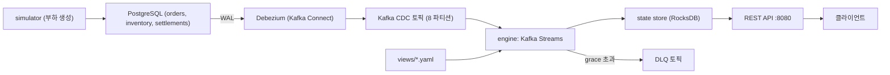
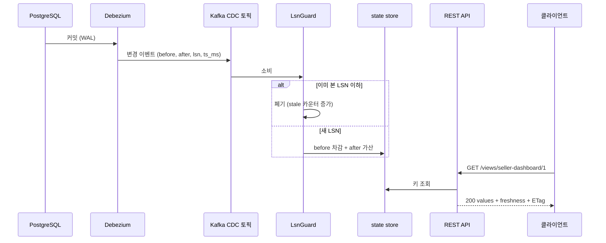

# cdc-view-engine

PostgreSQL 테이블이 바뀔 때마다 그 변경을 받아 조인/집계 결과(구체화 뷰)를 항상 최신으로 유지하고 REST API로 제공하는 엔진입니다.

## 왜 필요한가

여러 테이블(주문, 재고, 정산)이 각자 계속 바뀌는데, "판매자별 대시보드 집계"는 1초 안에 최신이어야 하는 상황을 생각해 보면 됩니다. 매번 DB에 무거운 집계 쿼리를 날리는 대신, DB 변경 기록(CDC - Change Data Capture, DB가 남기는 변경 로그를 읽어 이벤트로 흘려보내는 방식)을 실시간으로 받아 집계를 미리 계산해 둡니다.

어려운 부분은 이벤트 순서가 뒤집히거나, 같은 이벤트가 두 번 오거나, 처리 도중 프로세스가 죽거나, 테이블 스키마가 바뀌는 경우에도 뷰 값이 원본 DB와 정확히 맞아야 한다는 점입니다. 이 프로젝트는 그 부분을 직접 구현하고 실측으로 확인했습니다.

## 핵심 결과

- 정합성: 10만+ 이벤트(102,655건) 처리 후 소스 스냅샷 대비 뷰 전수 비교에서 불일치 0/100 그룹 (verdict=pass). 고의 오염 음성 테스트로 검증기가 "항상 0"을 내지 않음을 확인
- exactly-once: Kafka Streams EOS v2 + LSN(PostgreSQL 로그 위치 번호) 멱등 필터. 처리 도중 `kill -9` 후 재시작해도 뷰 값 정확 (count=200 / sum=20100, 유실·중복 0). 8파티션/8스레드에서도 유지
- 순서 뒤집힘: LSN 기준으로 오래된 이벤트 폐기, DELETE 후 늦게 온 UPDATE로 행이 부활하지 않음, 허용 지연(grace)을 넘긴 이벤트는 버리지 않고 DLQ(별도 보관 토픽)에 적재 + 카운터 증가
- 스키마 변경 중 무중단 재구축: 섀도(shadow) 뷰를 새로 만든 뒤 원자적으로 교체. 재구축~교체 구간 조회에서 5xx/빈/혼합 응답 0건. 재구축 상태는 DB에 저장되어 도중에 엔진이 죽어도 `ABORTED`로 확인 가능
- 성능: 10,000 events/sec, 10분 지속, DB 커밋 → 뷰 반영 p95 = 537ms (목표 ≤ 1s)
- 뷰는 코드가 아니라 YAML로 선언 (`views/*.yaml`)

## 동작 방식



1. Debezium이 PostgreSQL WAL(변경 로그)을 읽어 테이블별 변경 이벤트(before/after, LSN, 커밋 시각)를 Kafka에 넣습니다.
2. engine은 시작 시 `views/` 아래 YAML 뷰 정의를 읽고, 그에 맞는 Kafka Streams 토폴로지를 만듭니다.
3. 이벤트마다 LSN으로 중복/역순을 걸러낸 뒤 집계(count/count_distinct/sum/min/max/avg, tumbling/sliding 윈도우)를 갱신해 state store에 저장합니다.
4. REST API는 state store를 읽어 최신 값과 freshness(원본 커밋 시각, 반영 시각)를 돌려줍니다. ETag를 붙여 `If-None-Match` 일치 시 304를 응답합니다.



### 뷰 정의 예시

`views/seller-dashboard.yaml` - 주문 + 재고 + 정산을 `seller_id`로 조인·집계하는 비윈도우 뷰:

```yaml
name: seller-dashboard
sources:
  - table: orders
    join_key: seller_id
  - table: inventory
    join_key: seller_id
  - table: settlements
    join_key: seller_id
group_by: seller_id
aggregations:
  - function: sum
    source: orders
    column: amount
    as: total_order_amount
  - function: count
    source: orders
    as: order_count
  # ...
```

`views/seller-sales-window.yaml`은 판매자별 최근 10분 매출/주문수를 1분마다 갱신하는 sliding window 뷰입니다.

### API

| 메서드 | 경로 | 설명 |
|---|---|---|
| GET | `/views/{view}/{key}` | 비윈도우 뷰 최신 값 + freshness |
| GET | `/views/{view}/{key}?from={ms}&to={ms}` | 윈도우 뷰 시간 범위 결과 |
| POST | `/admin/verify/{view}` | 원본 DB 스냅샷과 뷰 비교 (정합성 검증) |
| POST | `/admin/views/{view}/rebuild` | 섀도 재구축 후 원자적 교체 |
| GET | `/admin/views/{view}/rebuild/status` | 재구축 상태 (`IDLE`, `VALIDATING`, `SNAPSHOTTING`, `CATCHING_UP`, `SWAPPED`, `FAILED`, `ABORTED`) |

없는 뷰/키는 404, 잘못된 파라미터는 400, Streams 준비 전에는 503을 돌려줍니다.

## 벤치마크

측정 환경: 단일 호스트 docker (macOS, 8 CPU / 16GB, Docker 8 NCPU / ~7.75GB). postgres, kafka, connect, engine, simulator가 같은 호스트를 공유합니다. 지연 = Debezium 커밋 시각(`ts_ms`) 대비 엔진 뷰 반영 시각, 워밍업 60초 제외.

최종 결과 (10,000 events/sec, 10분, [bench/reports/20260708-122749.md](bench/reports/20260708-122749.md)):

| 지표 | 값 |
|---|---|
| 판정 | PASS (목표 p95 ≤ 1000ms) |
| p50 | 134 ms |
| p95 | 537 ms |
| p99 | 1432 ms |
| 엔진 수신 처리량 (측정 구간) | 18,547 events/sec |
| 측정 종료 시 consumer lag | 0 events |
| DLQ 오적재 | 0 |

목표 달성까지의 튜닝 단계:

| SIM_RATE | 설정 | p50 | p95 | p99 | 판정 |
|---|---|---|---|---|---|
| 1,000/s | 기준선 (Debezium poll=500ms, 1파티션/1스레드) | 716ms | 1074ms | 1432ms | 미달 |
| 1,000/s | T1: poll.interval.ms 500→10, max.batch.size 2048→256 | 112ms | 179ms | 358ms | PASS |
| 10,000/s | T1만 (1파티션/1스레드) | >30s | >30s | >30s | FAIL (lag 831k 단조 증가) |
| 10,000/s | T1 + T2: 소스 파티션 1→8, `num.stream.threads` 1→8 | 134ms | 537ms | 1432ms | PASS |

- T1: 기준선에서 p50이 부하와 무관하게 716ms로 고정된 원인은 Debezium `poll.interval.ms`(기본 500ms)의 배치 대기였습니다.
- T2: 단일 스레드가 10,000/s를 따라가지 못해 lag이 계속 쌓였고, 파티션과 스레드를 8로 늘려 병렬화했습니다. 현재 기본값에 반영되어 있습니다.
- 이 결과는 8코어 단일 호스트에서 CPU를 거의 다 쓴 상태입니다. 더 높은 부하는 더 큰 호스트나 멀티 인스턴스가 필요합니다.

상세: [T1 지연 튜닝](.planning/t1-latency-tuning-verification.md), [T2 처리량 스케일링](.planning/t2-throughput-scaling-verification.md), [전체 리포트 목록](bench/reports/).

## 피처 조회 API

`ticket-fraud-engine`의 판정 엔진이 쓰는 계약(`POST /api/v1/features/query`)을 제공합니다. 뷰 YAML에 `features`를 선언하면 집계 필드가 `subject.name.window` 키로 노출됩니다.

```bash
curl -s localhost:8080/api/v1/features/query -H 'content-type: application/json' -d '{
  "subjectType": "CARD", "subjectKey": "card-1",
  "features": [{"name": "distinct_accounts", "window": "1d"}]
}'
# {"values":{"card.distinct_accounts.1d":2.0},"missing":[]}
```

- 값은 지금을 포함하는 윈도우 중 가장 오래된 것에서 읽습니다. sliding 뷰의 정밀도는 advance 단위이고 tumbling 뷰는 현재 고정 구간입니다.
- 구간에 행이 없으면 count, count_distinct, sum은 0입니다. 선언되지 않은 피처는 `missing`으로 응답합니다.
- `count_distinct`는 값별 행 수를 보관해 UPDATE와 DELETE를 정확히 되돌리고, 저장 공간은 고유 값 수에 비례합니다.

예시 뷰는 `examples/ticket-fraud-views/`에 있고, `views.directory`로 지정해 씁니다.

| 참조 키 | 상태 |
|---|---|
| account.payment_attempts.10m | 제공 |
| card.cumulative_amount.1d | 제공. 승인 건만 거르는 필터가 없어 모든 결제 행을 합산 |
| card.distinct_accounts.1d | 제공 |
| ip.distinct_accounts.1h | `missing`. `payment` 테이블에 IP 컬럼 없음 |
| account.hold_release_cycles.10m | `missing`. 선점 해제 이력 테이블 없음 |

계약과 집계는 단위 테스트로 검증했습니다. 두 서비스를 실제로 띄운 연동과 지연 측정은 아직 하지 않았습니다.

## 빠른 시작

필요: Docker (compose), `curl`, `jq`.

```bash
# 1) 전체 스택 기동 (postgres + kafka + connect + engine + simulator)
docker compose up -d --build

# 2) 판매자 대시보드 뷰 조회 (시뮬레이터가 채운 데이터)
curl -s http://localhost:8080/views/seller-dashboard/1 | jq

# 3) 정리
docker compose down -v
```

- 시뮬레이터 속도 조절: `SIM_RATE=500 docker compose up -d --build` (기본 100 events/sec)
- 데모 자동 확인: `bash scripts/demo-check.sh` (compose 기동부터 실데이터 조회까지 5분 타임아웃)

### 검증 스크립트

```bash
# exactly-once 카오스 테스트: 처리 도중 엔진 kill -9 후 재시작, 뷰 값이 기대값과 같은지 확인
bash scripts/chaos-restart-test.sh

# 정합성 검증: 소스 스냅샷 기대값 vs 서빙 중인 뷰
curl -X POST http://localhost:8080/admin/verify/seller-dashboard | jq

# 벤치마크: 결과가 bench/reports/ 에 생성됨
bash bench/run-bench.sh                              # 기본 SIM_RATE=10000, DURATION_SEC=600, WARMUP_SEC=60
SIM_RATE=1000 DURATION_SEC=300 bash bench/run-bench.sh
```

## 테스트

Java 21 필요.

```bash
./gradlew :engine:test
```

- engine 테스트 18개 클래스, 64개 테스트. 마지막 로컬 실행 결과: 59 통과, 5 건너뜀, 0 실패
- 건너뛴 5개는 Testcontainers로 PostgreSQL을 띄우는 통합 테스트(`ReplicaIdentityCheckerIT`, `JdbcRebuildStateStoreIT`)로, Docker를 쓸 수 없으면 자동으로 건너뜁니다. 로컬에서 실행하려면 `DOCKER_API_VERSION=1.44`가 필요할 수 있습니다.
- GitHub Actions CI(`.github/workflows/ci.yml`)가 push(master)와 pull request마다 `./gradlew test`를 실행합니다.

## 범위 밖 (하지 않은 것)

- Materialize, RisingWave 같은 범용 SQL 스트리밍 DB가 아닙니다. 뷰는 YAML로 선언하는 조인/집계 프리셋으로 한정됩니다.
- 단일 인스턴스 전제입니다. 수평 확장(멀티 노드, interactive query 라우팅)은 다루지 않습니다.
- 소스는 PostgreSQL(Debezium) 하나뿐입니다. 외부 캐시 무효화, 관리 UI, 인증은 없습니다.
- 윈도우 뷰의 정합성 검증은 지원하지 않습니다 (요청 시 400으로 거부).
- EOS와 state store는 Kafka Streams 기능을 그대로 씁니다. 이 프로젝트가 직접 만든 부분은 그 위의 순서 처리, 중복 방지, 재구축, 정합성 검증 계층입니다.

## 프로젝트 구조

```
cdc-view-engine/
├── engine/            # Spring Boot + Kafka Streams 엔진
│   └── src/main/java/io/github/nini4746/cdcview/
│       ├── cdc/       # Debezium 커넥터 등록, 변경 이벤트 파싱
│       ├── config/    # YAML 뷰 정의 로딩/검증
│       ├── topology/  # Streams 토폴로지, EOS 설정
│       ├── ordering/  # LSN 가드, 지각 이벤트/DLQ
│       ├── api/       # 뷰 조회, 피처 조회 REST API
│       ├── verify/    # 정합성 검증기
│       └── rebuild/   # 섀도 재구축 + 원자적 교체
├── simulator/         # 커머스 부하 생성기
├── views/             # 뷰 정의 YAML
├── examples/          # ticket-fraud-views 예시 뷰
├── docker/postgres/   # init.sql
├── bench/             # run-bench.sh, reports/
├── scripts/           # demo-check.sh, chaos-restart-test.sh
└── docker-compose.yml
```

## 더 보기

- [docs/SRS.md](docs/SRS.md) - 요구사항 명세
- [docs/SDS.md](docs/SDS.md) - 설계 명세: 구성도, 시퀀스, ERD/자료구조, 모듈
- [SPEC](.planning/SPEC.md) - 요구사항과 수용 기준
- [최종 완료 리포트](.planning/v4-completion-report.md) - 수용 기준별 테스트/실측 근거
- [정합성·카오스 검증](.planning/v2-consistency-chaos-verification.md)
- [벤치 하네스 검증](.planning/v3-benchmark-verification.md)
- [진행 상태](.planning/STATE.md)
