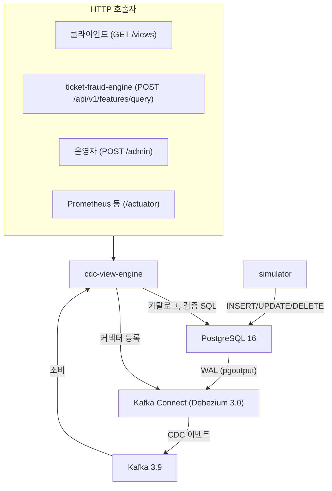
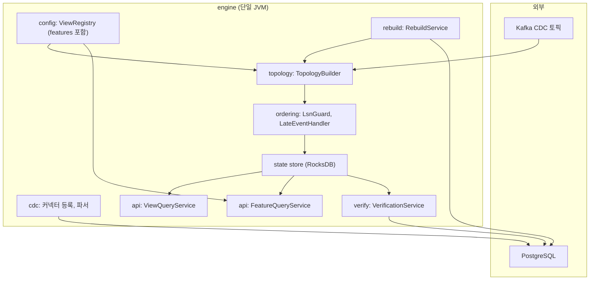
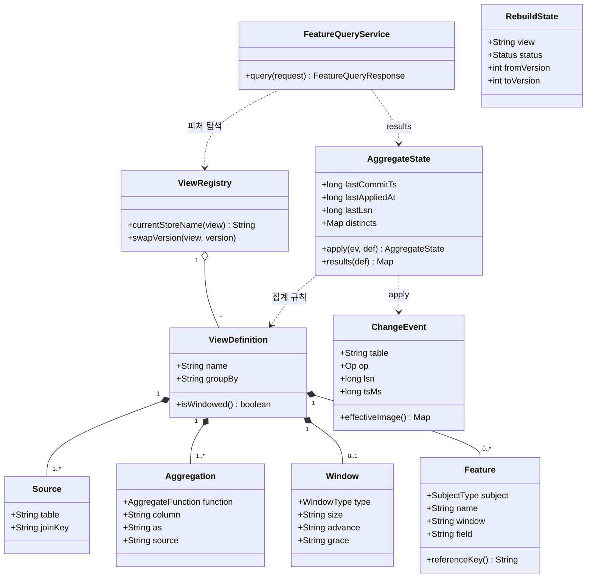
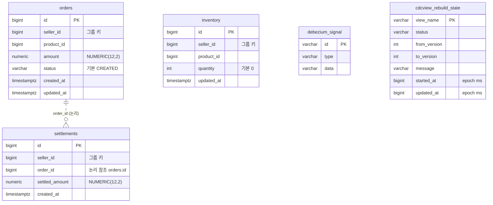
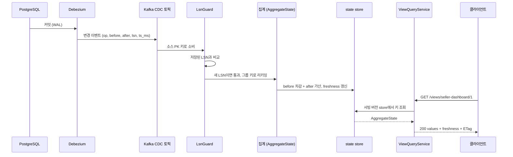
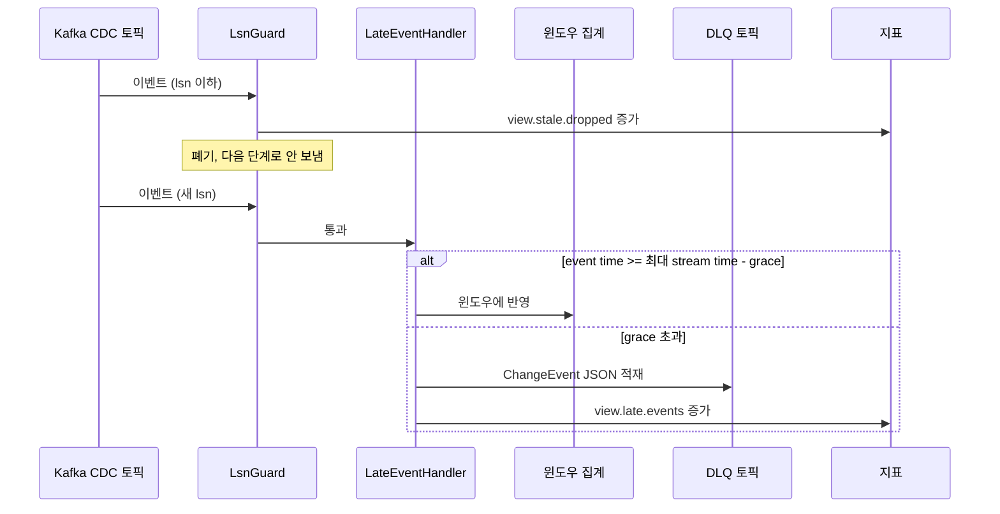
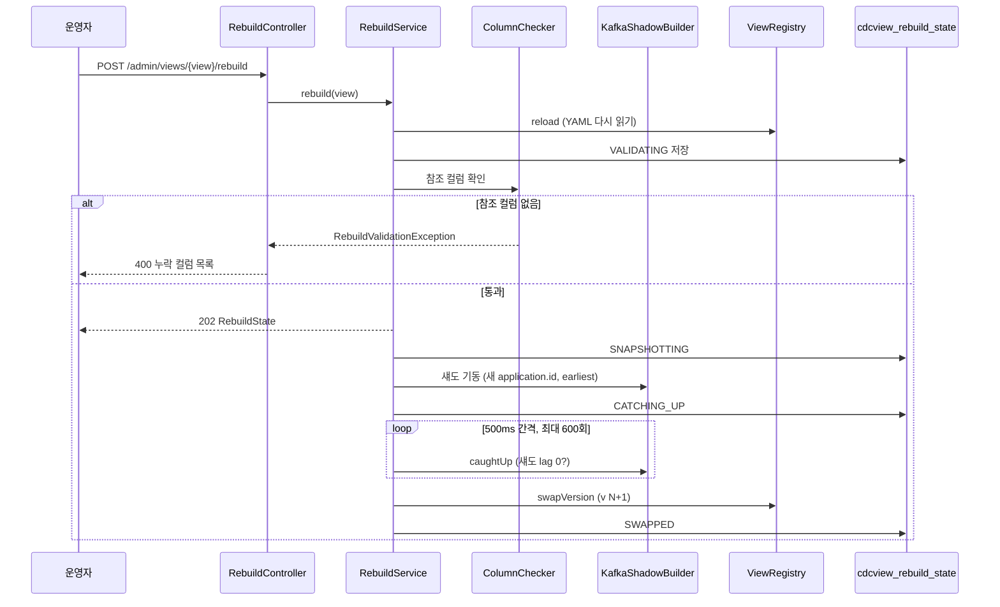
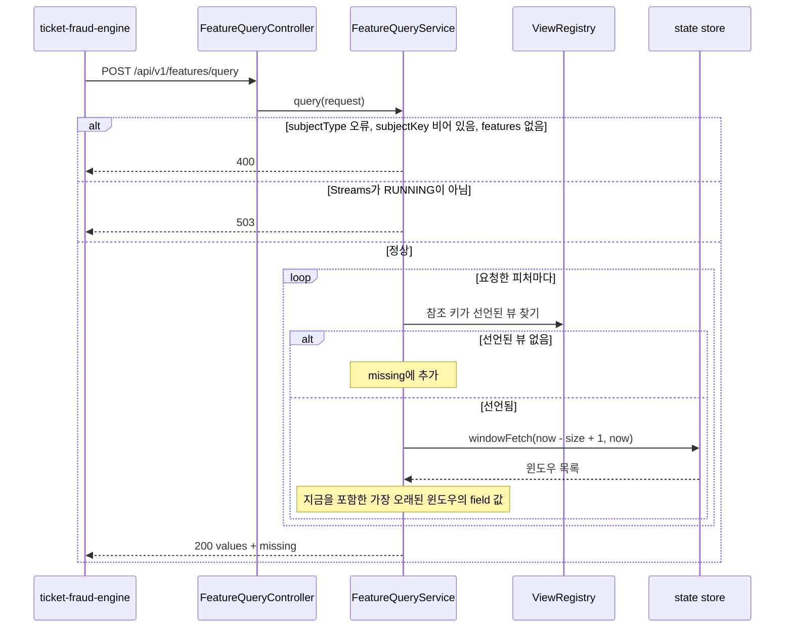
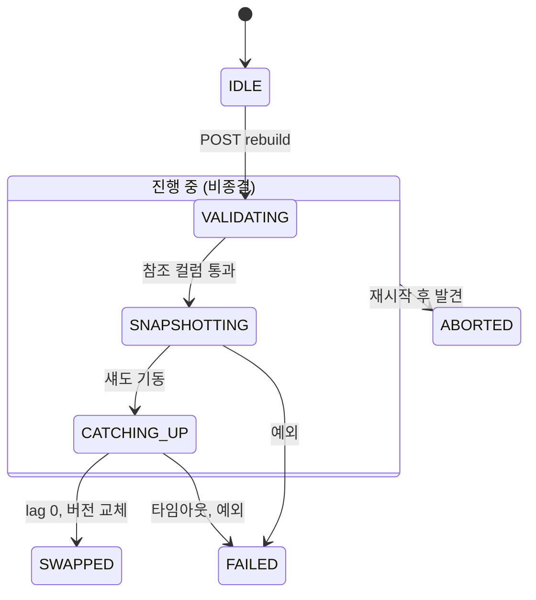

# cdc-view-engine 소프트웨어 설계 명세서 (SDS)

| 문서 | 버전 | 작성일 | 기준 표준 |
|---|---|---|---|
| cdc-view-engine SDS | 1.0 | 2026-11-18 | IEEE 1016-2009 |

## 1. 소개

### 1.1 목적

이 문서는 [SRS](SRS.md)의 요구사항을 cdc-view-engine이 어떻게 구현하는지 설명합니다. 구성 요소, 데이터, 인터페이스, 주요 흐름, 상태 전이, 알고리즘, 설계 근거를 다룹니다.

### 1.2 범위

`engine`(Spring Boot + Kafka Streams 서버)과 이를 둘러싼 데모 스택(PostgreSQL, Kafka, Debezium Connect, `simulator`)을 다룹니다. 원본 DB 변경이 Kafka CDC 토픽을 거쳐 RocksDB state store의 집계 뷰가 되고, REST(뷰 조회, 피처 조회)로 조회되기까지의 전 경로가 대상입니다. 판정 엔진용 예시 뷰(`examples/ticket-fraud-views/`)도 포함합니다.

### 1.3 용어 정의

[SRS 1.4 용어 정의](SRS.md#14-용어-정의)를 따릅니다. 이 문서에서 추가로 쓰는 용어는 다음과 같습니다.

| 용어 | 뜻 |
|---|---|
| 토폴로지 | Kafka Streams 처리 그래프 (소스 → 처리기 → state store) |
| 서빙 버전 | 뷰 조회가 읽는 store 버전. store 이름은 `view-{name}-v{N}` |
| 메인 인스턴스 | 부팅 시 모든 뷰 토폴로지를 띄우는 `KafkaStreams` (`application.id=cdc-view-engine`) |
| 섀도 인스턴스 | 재구축 시 새 `application.id`로 띄우는 별도 `KafkaStreams` |

### 1.4 참고 문서

| 문서 | 내용 |
|---|---|
| [SRS](SRS.md) | 요구사항 명세 (FR/NFR, 추적표) |
| [README](../README.md) | 개요, 빠른 시작, 벤치마크 요약 |
| [SPEC](../.planning/SPEC.md) | 원본 요구사항과 아키텍처 결정 |
| [최종 완료 리포트](../.planning/v4-completion-report.md) | 수용 기준별 근거 |
| [T1 지연 튜닝](../.planning/t1-latency-tuning-verification.md), [T2 처리량 스케일링](../.planning/t2-throughput-scaling-verification.md) | 성능 설정값의 근거 |
| [docker/postgres/init.sql](../docker/postgres/init.sql) | DB 스키마 |
| [examples/ticket-fraud-views](../examples/ticket-fraud-views/) | 피처 선언 예시 뷰 |

## 2. 설계 이해관계자와 관심사

| 이해관계자 | 관심사 | 다루는 뷰 |
|---|---|---|
| 서비스 개발자 (API 사용자) | 조회 경로, 응답 형식, 상태 코드, 캐시 검증 | 3.5 인터페이스, 3.6 상호작용 |
| 판정 엔진 (`ticket-fraud-engine`) | 피처 조회 계약, 참조 키, `missing` 의미, 빈 구간 값 | 3.4.5 뷰 정의 YAML, 3.5.1 REST API, 3.6.4, 3.8.7 |
| 운영자 | 정합성 검증, 재구축 절차와 상태, 장애 시 동작, 지표 | 3.6 상호작용, 3.7 상태 동적, 3.9 자원, 5 오류 처리 |
| 엔진 개발자 | 모듈 경계, 증분 집계와 순서 처리 알고리즘, 확장 지점 | 3.2 구성, 3.3 논리, 3.8 알고리즘, 4 설계 근거 |
| 데이터 담당자 | 소스 스키마, state store와 토픽 구조, 이벤트 형식 | 3.4 정보 |
| 검토자 | 요구사항이 어떤 설계 요소로 충족되는지 | 6 요구사항-설계 추적 |

## 3. 설계 뷰

### 3.1 컨텍스트 뷰

엔진을 하나의 블랙박스로 보고 외부 행위자와 시스템을 표시합니다.



| 외부 요소 | 엔진과의 관계 |
|---|---|
| PostgreSQL | 원본 데이터. 엔진은 카탈로그 조회, 정합성 검증 SQL, 재구축 상태 테이블(`cdcview_rebuild_state`) 쓰기만 수행 |
| Kafka Connect (Debezium) | 엔진이 부팅 시 커넥터 설정을 등록. 이후 WAL을 읽어 CDC 토픽에 씀 |
| Kafka | CDC 토픽 소비, DLQ 토픽 생산, Streams 내부 토픽(repartition, changelog), consumer lag 조회 |
| 클라이언트 / 운영자 | REST 호출 |
| `ticket-fraud-engine` | 피처 조회 API 소비자. 두 서비스를 실제로 띄운 연동은 아직 하지 않음 (README) |
| simulator | PG에 직접 쓰는 부하 생성기 (Kafka에 직접 쓰지 않음) |

### 3.2 구성 뷰



| 구성 요소 | 역할 | 기술 |
|---|---|---|
| `config` | `views/*.yaml` 로딩·검증(`features` 선언 포함), 뷰명 → 서빙 store 버전 해석, 기간 표기 파싱(`ms`/`s`/`m`/`h`/`d`) | Jackson YAML, Spring `@ConfigurationProperties` |
| `cdc` | REPLICA IDENTITY 검사, Debezium 커넥터 등록, CDC 토픽 선생성, Debezium envelope 파싱, 수신/지연 지표 | Spring `RestClient`, Kafka AdminClient, Jackson, Micrometer |
| `topology` | 뷰 정의 → Streams 토폴로지 생성, EOS v2 설정, 메인 인스턴스 라이프사이클 | Kafka Streams |
| `ordering` | 행 단위 LSN 가드(역순/중복 폐기), grace 초과 이벤트 DLQ 분기 | Kafka Streams Processor API, RocksDB store |
| state store | 뷰 집계 상태와 LSN 가드 상태 저장. changelog 토픽으로 복원 | RocksDB (Kafka Streams 내장) |
| `api` | 뷰 조회 REST, ETag/304, 메인+섀도 인스턴스 store 탐색, 피처 조회 REST(`FeatureQueryController`, `FeatureQueryService`) | Spring MVC, Kafka Streams interactive query |
| `verify` | 원본 스냅샷 기대값 계산과 뷰 비교, quiesce 판정 | JDBC (REPEATABLE READ), Kafka AdminClient |
| `rebuild` | 참조 컬럼 검증, 섀도 빌드, 따라잡기 감시, 원자적 교체, 상태 영속화 | Kafka Streams, JDBC |
| `simulator` | 주문/재고/정산 변경을 설정 속도로 생성 | JDBC, HikariCP |

부팅 순서는 `ApplicationRunner`의 `@Order`로 고정됩니다: `ConnectorRegistrar`(10) → `CdcTopicProvisioner`(15) → `StreamsManager`(20). `ViewRegistry`는 그보다 앞서 `@PostConstruct`에서 로딩됩니다.

### 3.3 논리 뷰



| 타입 | 파일 | 설명 |
|---|---|---|
| `ViewDefinition` | `config/ViewDefinition.java` | YAML 뷰 정의. `AggregateFunction` = COUNT, COUNT_DISTINCT, SUM, MIN, MAX, AVG. `WindowType` = TUMBLING, SLIDING. `features`가 없으면 빈 목록 |
| `Feature` | `config/ViewDefinition.java` | 집계 필드를 참조 키 `subject.name.window`로 노출하는 선언. `SubjectType` = ACCOUNT, IP, CARD. 주체 키는 뷰의 `group_by` 값 |
| `ChangeEvent` | `cdc/ChangeEvent.java` | 내부 이벤트 record: `table`, `op`(CREATE/UPDATE/DELETE/READ), `before`, `after`, `lsn`, `tsMs` |
| `AggregateState` | `topology/AggregateState.java` | 그룹 키 하나의 누산 상태. state store 값 |
| `ViewRegistry` | `config/ViewRegistry.java` | 뷰 정의 맵 + 뷰별 서빙 버전 맵 |
| `RebuildState` | `rebuild/RebuildState.java` | 재구축 진행 상태 record. `Status` = IDLE, VALIDATING, SNAPSHOTTING, CATCHING_UP, SWAPPED, FAILED, ABORTED |
| `StoreAccess` | `api/StoreAccess.java` | store 조회 추상화 (`get`, `windowFetch`, `scanAll`). 프로덕션은 `KafkaStreamsStoreAccess` |
| `FeatureQueryService` | `api/FeatureQueryService.java` | 요청 검증, 참조 키로 피처 탐색, 윈도우 store에서 값 읽기. 테스트용으로 `Clock` 주입 가능 (기본 `Clock.systemUTC()`) |
| `FeatureQueryRequest`, `FeatureRef`, `FeatureQueryResponse` | `api/dto.java` | 피처 조회 요청/응답 record |
| `ShadowBuilder` | `rebuild/ShadowBuilder.java` | 섀도 빌드 추상화 (`startShadow`, `caughtUp`, `promote`, `discard`). 프로덕션은 `KafkaShadowBuilder` |
| `RebuildStateStore` | `rebuild/RebuildStateStore.java` | 재구축 상태 영속화 (`save`, `find`). 프로덕션은 `JdbcRebuildStateStore` |
| `QuiesceChecker` | `verify/QuiesceChecker.java` | consumer lag 합계, `isQuiesced()` = lag 0 |

### 3.4 정보 뷰

#### 3.4.1 관계형 데이터 (PostgreSQL)

`docker/postgres/init.sql` 기준입니다. 선언된 FK 제약은 없습니다. 아래 관계선은 논리 참조입니다.



| 테이블 | 용도 | 주요 컬럼 / 비고 |
|---|---|---|
| `orders` | 주문 (CDC 소스) | `seller_id`로 그룹. `amount`는 sum 대상. `REPLICA IDENTITY FULL` |
| `inventory` | 재고 (CDC 소스) | `quantity`는 min 대상. `REPLICA IDENTITY FULL` |
| `settlements` | 정산 (CDC 소스) | `settled_amount`는 sum 대상. `REPLICA IDENTITY FULL` |
| `debezium_signal` | Debezium 시그널 테이블 | 커넥터 설정 `signal.data.collection`으로 지정됨. 현재 엔진 코드는 이 테이블에 쓰지 않음 |
| `cdcview_rebuild_state` | 재구축 상태 (뷰당 최신 1건) | `ON CONFLICT (view_name) DO UPDATE` upsert. 엔진이 첫 사용 시 `CREATE TABLE IF NOT EXISTS`로도 생성 |

#### 3.4.2 state store (RocksDB)

| store 이름 | 종류 | 키 | 값 |
|---|---|---|---|
| `view-{name}-v{N}` (비윈도우) | KeyValue | 그룹 키 문자열 (예: `seller_id` 값) | `AggregateState` JSON |
| `view-{name}-v{N}` (윈도우) | Window | 그룹 키 + 윈도우 시작 시각 | `AggregateState` JSON |
| `lsn-guard-{view}-{table}` | KeyValue (persistent) | `{table}\|{소스 레코드 키}` | 그 행에서 본 최고 LSN (`Long`) |

`AggregateState` 필드:

| 필드 | 타입 | 설명 |
|---|---|---|
| `counters` | `Map<String, Long>` | COUNT 결과 필드 → 행 수 |
| `sums` | `Map<String, Double>` | SUM 결과 필드 → 합 |
| `avgSums`, `avgCounts` | `Map<String, Double>`, `Map<String, Long>` | AVG 분자, 분모 |
| `extremes` | `Map<String, Map<String, Integer>>` | MIN/MAX 결과 필드 → (값 → 개수) 멀티셋 |
| `distincts` | `Map<String, Map<String, Integer>>` | COUNT_DISTINCT 결과 필드 → (값 문자열 → 행 수). 크기는 고유 값 수에 비례 |
| `lastCommitTs` | `long` | 반영된 이벤트 중 최대 `ts_ms` |
| `lastAppliedAt` | `long` | 마지막 반영 시각 (엔진 wall clock) |
| `lastLsn` | `long` | 마지막 반영 이벤트의 LSN (ETag에 사용) |

#### 3.4.3 Kafka 토픽

| 토픽 | 생산자 | 내용 |
|---|---|---|
| `cdcview.public.orders`, `cdcview.public.inventory`, `cdcview.public.settlements` | Debezium | CDC 이벤트. 이름 규칙 `{topic.prefix}.{schema}.{table}`. 엔진이 기동 전 파티션 8(`CONNECT_SOURCE_PARTITIONS`), RF 1로 선생성 |
| `cdcview.dlq.late-events` | 엔진 (`LateEventHandler`) | grace 초과 지각 이벤트. 값은 `ChangeEvent` JSON |
| `cdcview_connect_configs`, `cdcview_connect_offsets`, `cdcview_connect_statuses` | Kafka Connect | Connect 내부 저장 토픽 |
| Streams 내부 토픽 (repartition, changelog) | Kafka Streams | 그룹 키 리키잉, store 복원용 |

#### 3.4.4 CDC 이벤트 형식 (Debezium JSON)

커넥터는 `value.converter.schemas.enable=false`라 값은 스키마 래퍼 없는 payload입니다. 파서는 `payload` 래퍼가 있으면 벗겨냅니다.

| 필드 | 사용처 |
|---|---|
| `op` | `c`=CREATE, `u`=UPDATE, `d`=DELETE, `r`=READ(초기 스냅샷) |
| `before` | UPDATE/DELETE 차감용 이전 행 |
| `after` | INSERT/UPDATE/스냅샷 가산용 이후 행 |
| `source.table` | 소스 테이블명 |
| `source.lsn` | 순서 기준 |
| `source.ts_ms` | event time, 지연 측정 기준 |

NUMERIC은 `decimal.handling.mode=double`로 double로 도착합니다. DELETE tombstone은 `tombstones.on.delete=false`로 만들지 않습니다.

#### 3.4.5 뷰 정의 YAML

| 필드 | 필수 | 설명 |
|---|---|---|
| `name` | 예 | 뷰 이름 (중복 금지) |
| `description` | 아니오 | 설명 |
| `sources[].table` | 예 | 소스 테이블 |
| `sources[].join_key` | 소스 2개 이상이면 예 | 그 테이블의 그룹 값 컬럼. 생략 시 `group_by` |
| `group_by` | 예 | 그룹 키 |
| `aggregations[].function` | 예 | `count`, `count_distinct`, `sum`, `min`, `max`, `avg` |
| `aggregations[].column` | count 외 예 | 집계 대상 컬럼 |
| `aggregations[].as` | 예 | 결과 필드명 (중복 금지) |
| `aggregations[].source` | 소스 2개 이상이면 예 | 컬럼이 속한 테이블 |
| `window.type` | 윈도우 시 예 | `tumbling`, `sliding` |
| `window.size` | 윈도우 시 예 | 기간 (`500ms`, `30s`, `10m`, `1h`, `1d` 형식) |
| `window.advance` | sliding이면 예 | 이동 간격 |
| `window.grace` | 아니오 | 기본 `30s` |
| `features` | 아니오 | 피처 목록. 생략 시 빈 목록, 목록이 아니면 부팅 실패. 윈도우 뷰에만 허용 |
| `features[].subject` | 예 | `ACCOUNT`, `IP`, `CARD` |
| `features[].name` | 예 | 피처 이름 (참조 키의 가운데) |
| `features[].window` | 예 | 참조 키의 윈도우 표기. 뷰의 `window.size`와 같은 길이여야 함 |
| `features[].field` | 예 | 값을 읽을 집계 결과 필드(`aggregations[].as`) |

예시 뷰 (`examples/ticket-fraud-views/`, 소스 `payment`):

| 파일 | 윈도우 | 집계 | 노출 피처 |
|---|---|---|---|
| `account-payment-attempts.yaml` | sliding 10m, advance 1m, grace 30s, `group_by: account_id` | `count` → `payment_attempts` | `account.payment_attempts.10m` |
| `card-daily.yaml` | tumbling 1d (UTC 당일), grace 30s, `group_by: card_fingerprint` | `sum(amount)` → `cumulative_amount`, `count_distinct(account_id)` → `distinct_accounts` | `card.cumulative_amount.1d`, `card.distinct_accounts.1d` |

`ip.distinct_accounts.1h`(`payment` 테이블에 IP 컬럼 없음)와 `account.hold_release_cycles.10m`(선점 해제 이력 테이블 없음)은 선언하지 않았으므로 `missing`으로 응답합니다. `card.cumulative_amount.1d`는 승인 건만 거르는 필터가 없어 모든 결제 행을 합산합니다.

### 3.5 인터페이스 뷰

#### 3.5.1 REST API

| 메서드 | 경로 | 설명 | 응답 |
|---|---|---|---|
| GET | `/views/{view}/{key}` | 비윈도우 뷰 최신 값 | 200 `{view, key, values, freshness{sourceCommitTs, appliedAt}, version}` + ETag `"v{version}-{lastLsn}"`. `If-None-Match` 일치 시 304 |
| GET | `/views/{view}/{key}?from={ms}&to={ms}` | 윈도우 뷰 범위 조회 | 200 `{view, key, windows[{start, end, values, freshness}]}` + ETag `"v{version}-w{maxLsn}"`. 304 동일 |
| POST | `/api/v1/features/query` | 피처 조회. 요청 `{subjectType, subjectKey, features[{name, window}]}` | 200 `{values{참조 키: 값(double)}, missing[참조 키]}` |
| POST | `/admin/verify/{view}` | 정합성 검증 (동기) | 200 `{view, quiesced, verdict, mismatchCount, samples, expectedGroups, actualGroups, durationMs}`. `verdict`는 `pass`/`fail`, non-quiesced면 `null` |
| POST | `/admin/views/{view}/rebuild` | 재구축 요청 (비동기) | 202 `RebuildState` |
| GET | `/admin/views/{view}/rebuild/status` | 재구축 상태 | 200 `RebuildState` `{view, status, fromVersion, toVersion, message, startedAt, updatedAt}` |
| GET | `/actuator/health`, `/actuator/metrics`, `/actuator/prometheus` | 헬스, 지표 | Spring Boot Actuator 기본 |

오류 응답:

| 상황 | 상태 | 바디 |
|---|---|---|
| 없는 뷰 / 키 / 범위 내 윈도우 없음 (조회) | 404 | `{error, view, key}` |
| 윈도우 뷰에 from/to 없음, 비윈도우 뷰에 from/to, from 또는 to 하나만, `from > to` | 400 | `{error, view, key}` |
| Streams가 RUNNING이 아님, store 준비 전 | 503 | `{error, view: null, key: null}` |
| 피처 조회: `subjectType`이 ACCOUNT/IP/CARD가 아님, `subjectKey` 비어 있음, `features` 없음 | 400 | `{error, view: "features", key}` |
| 피처 조회: Streams가 RUNNING이 아님 | 503 | `{error, view: null, key: null}` |
| 피처 조회: 선언되지 않은 피처 | 200 | 에러 아님. `missing`에 참조 키 |
| 검증: 없는 뷰 | 404 | 메시지 문자열 |
| 검증: 윈도우 뷰 | 400 | 메시지 문자열 |
| 재구축: 참조 컬럼 없음 | 400 | 메시지 문자열 (누락 `table.column` 목록) |
| 재구축: 없는 뷰 | 404 | 메시지 문자열 |
| 재구축: 이미 진행 중 | 409 | 메시지 문자열 |

#### 3.5.2 지표

| 이름 | 종류 | 태그 | 설명 |
|---|---|---|---|
| `cdc.events.received` | Counter | `table` | 수신·파싱한 CDC 이벤트 수 |
| `view.apply.latency` | Timer (p50/p95/p99 + histogram) | `view` | PG 커밋(`ts_ms`) 대비 뷰 반영 지연 |
| `view.stale.dropped` | Counter | `view` | LSN이 낮아 폐기한 stale/중복 이벤트 수 |
| `view.late.events` | Counter | `view` | grace 초과로 DLQ에 적재한 이벤트 수 |

#### 3.5.3 외부 시스템 호출

| 대상 | 호출 | 시점 |
|---|---|---|
| Kafka Connect | `PUT /connectors/cdcview-postgres/config` (멱등) | 부팅 |
| PostgreSQL | `pg_class` + `pg_namespace`에서 `relreplident` 조회 | 부팅 (커넥터 등록 전) |
| PostgreSQL | `information_schema.columns` 조회 | 재구축 요청 |
| PostgreSQL | 소스 테이블별 `GROUP BY` 집계 SQL | 검증 요청 |
| Kafka AdminClient | `listTopics`, `createTopics` | 부팅 |
| Kafka AdminClient | `listConsumerGroupOffsets`, `listOffsets` | 검증(quiesce), 재구축(섀도 lag) |

### 3.6 상호작용 뷰

#### 3.6.1 CDC 이벤트에서 뷰 갱신과 조회까지 (정상 경로)



LSN 가드는 리키잉 전에 소스 PK 단위로 적용됩니다. 집계 상태와 LSN 상태는 EOS v2 트랜잭션 안에서 함께 커밋되므로 재시작 후에도 어긋나지 않습니다.

#### 3.6.2 역순, 중복, 지각 이벤트 (실패 경로)



역순 UPDATE와 동일 LSN 재전달은 LSN 가드에서, grace 초과 이벤트는 윈도우 뷰의 `LateEventHandler`에서 처리됩니다. 어느 경우도 흔적 없이 사라지지 않습니다.

#### 3.6.3 스키마 변경 후 재구축



교체 전까지 조회는 기존 버전 store를 읽습니다. 교체는 `ViewRegistry`의 서빙 버전 값 하나를 바꾸는 것이라 중간 상태가 없습니다. 따라잡기 타임아웃이나 예외가 나면 섀도를 정리하고 `FAILED`로 기록하며, 기존 버전 서빙은 그대로입니다.

#### 3.6.4 피처 조회



두 서비스를 실제로 띄운 연동과 지연 측정은 아직 하지 않았습니다. 이 흐름은 `FeatureQueryApiTest`(`MockMvc` + 페이크 `StoreAccess`)로만 검증했습니다.

### 3.7 상태 동적 뷰

재구축 상태(`RebuildState.Status`)의 전이입니다. `IDLE`은 저장 레코드가 없을 때 `status` 조회가 돌려주는 값입니다.



| 상태 | 종결 | 의미 |
|---|---|---|
| `IDLE` | - | 재구축 기록 없음 |
| `VALIDATING` | 아니오 | 뷰 정의 재로딩, 참조 컬럼 검증 중 |
| `SNAPSHOTTING` | 아니오 | 섀도 스트림 기동 |
| `CATCHING_UP` | 아니오 | 섀도가 라이브 오프셋을 따라잡기를 대기 |
| `SWAPPED` | 예 | 새 버전으로 교체 완료 |
| `FAILED` | 예 | 파이프라인 실패. 섀도 정리, 기존 버전 유지 |
| `ABORTED` | 예 | 재시작 후 비종결 레코드를 발견해 전환. 기존 버전 유지 |

비종결 상태에서 다시 요청하면 409입니다. 종결 상태(`SWAPPED`, `FAILED`, `ABORTED`)에서 다시 요청하면 `VALIDATING`부터 새로 시작합니다 (그림에서는 생략). `ABORTED` 전환은 재시작 후 처음 `status` 또는 `rebuild`가 호출될 때 일어납니다.

### 3.8 알고리즘 뷰

#### 3.8.1 LSN 가드 (`ordering/LsnGuard.java`)

```
on record(key=소스 PK, ev):
    rowKey = ev.table + "|" + key
    seen = store.get(rowKey)
    if seen != null and ev.lsn <= seen:
        view.stale.dropped += 1
        return                      # 역순 또는 동일 LSN 중복 폐기
    store.put(rowKey, ev.lsn)       # DELETE도 LSN을 갱신
    forward(ev)
```

DELETE도 LSN을 기록하므로, 뒤늦게 온 낮은 LSN의 UPDATE로 행이 되살아나지 않습니다. 동일 LSN 재전달도 "이하" 조건에 걸려 집계에 두 번 들어가지 않습니다. tombstone LSN의 TTL 정리는 하지 않습니다.

#### 3.8.2 증분 집계 (`topology/AggregateState.java`)

```
apply(ev):
    CREATE, READ: mutate(after, +1)
    DELETE:       mutate(before, -1)
    UPDATE:       mutate(before, -1); mutate(after, +1)
    lastCommitTs = max(lastCommitTs, ev.tsMs)
    lastLsn = ev.lsn
    lastAppliedAt = now

mutate(image, sign):
    for agg in 이 테이블에 해당하는 집계:
        COUNT: counters[as] += sign
        SUM:   sums[as] += sign * image[column]
        AVG:   avgSums[as] += sign * v, avgCounts[as] += sign
        MIN/MAX: extremes[as][v] += sign (0 이하면 제거)
        COUNT_DISTINCT: v가 null이 아니면 distincts[as][str(v)] += sign (0 이하면 제거)
```

다중 소스 뷰는 집계의 `source`가 이벤트 테이블과 같을 때만 반영합니다. MIN/MAX는 값 멀티셋을 유지해 DELETE 후에도 다시 계산할 수 있습니다. 결과는 `results()`에서 멀티셋의 최소/최대를 골라 냅니다. COUNT_DISTINCT는 값별 행 수를 보관하므로 같은 값의 행이 남아 있으면 DELETE 후에도 그 값이 유지되고, 결과는 `distincts[as]`의 키 개수입니다. NULL은 세지 않고(SQL `COUNT(DISTINCT)`와 같음), 숫자가 아닌 식별자도 허용합니다.

#### 3.8.3 토폴로지 구성 (`topology/TopologyBuilder.java`)

1. 뷰의 소스 테이블마다 CDC 토픽을 `EventTimeExtractor`(event time = `ts_ms`)로 소비
2. 테이블별 `LsnGuard` 적용 후 `join_key` 값으로 `selectKey`
3. 소스 스트림들을 `merge`
4. 윈도우 뷰면 `LateEventHandler`로 지각 이벤트 분기
5. `groupByKey` 후 비윈도우는 `aggregate`(KeyValue store), 윈도우는 `windowedBy(TimeWindows)` 후 `aggregate`(Window store)
6. 집계마다 `view.apply.latency`에 `now - ts_ms` 기록

조인은 행 단위 KTable 조인이 아니라 "소스별로 같은 그룹 키에 누적"하는 방식입니다. sliding은 `TimeWindows.ofSizeAndGrace(size, grace).advanceBy(advance)`, tumbling은 `advance = size`입니다.

#### 3.8.4 지각 판정 (`ordering/LateEventHandler.java`)

```
maxStreamTime = -inf  (태스크별 인메모리)
on record(ts):
    late = maxStreamTime != -inf and ts < maxStreamTime - grace
    maxStreamTime = max(maxStreamTime, ts)
    late이면 DLQ 브랜치, 아니면 정시 브랜치
```

#### 3.8.5 정합성 검증 (`verify/`)

1. `QuiesceChecker`로 메인 consumer group lag 합계를 구함. 0이면 quiesced
2. `REPEATABLE READ` 읽기 전용 트랜잭션에서 소스 테이블별 `SELECT {join_key} AS group_key, 집계... GROUP BY {join_key}` 실행 후 그룹 키로 병합 (COUNT는 `COUNT(*)`, COUNT_DISTINCT는 `COUNT(DISTINCT c)`, SUM은 `COALESCE(SUM(c),0)`)
3. 서빙 store를 read-only로 전체 스캔해 `results()` 계산
4. 두 키 집합의 합집합을 돌며 한쪽에만 있거나 필드 값 차이가 `1e-6` 이상이면 불일치
5. quiesced면 `pass`/`fail`, 아니면 `verdict=null`. 샘플은 최대 10건

#### 3.8.6 섀도 따라잡기 판정 (`rebuild/KafkaShadowBuilder.java`)

섀도 consumer group(`cdc-view-engine-shadow-{view}-v{N}`)의 커밋 오프셋과 각 파티션 끝 오프셋 차이를 더합니다. 커밋이 아직 없거나 조회가 실패하면 `Long.MAX_VALUE`로 보고 미완으로 처리합니다. 섀도 상태가 RUNNING/REBALANCING이고 lag이 0이면 따라잡은 것으로 봅니다.

#### 3.8.7 피처 값 읽기 (`api/FeatureQueryService.java`)

```
query(subjectType, subjectKey, features):
    subjectType이 ACCOUNT/IP/CARD가 아니거나 subjectKey가 비었거나 features가 없으면 400
    Streams가 RUNNING이 아니면 503
    for (name, window) in features:
        ref = lower(subjectType) + "." + name + "." + window
        ref를 선언한 (뷰, 피처)를 모든 뷰에서 찾음. 없으면 missing에 추가
        now = clock.millis(); size = 뷰 window.size
        rows = windowFetch(서빙 store, subjectKey, now - size + 1, now)
               중 시작 시각이 (now - size, now] 인 것
        rows가 비면: COUNT, COUNT_DISTINCT, SUM은 0, MIN/MAX/AVG는 missing
        아니면 시작 시각이 가장 이른 윈도우의 results()[field]
        값이 숫자가 아니면 missing
```

지금을 포함하는 윈도우 중 가장 오래된 것이 최근 구간을 가장 많이 덮습니다. sliding 뷰의 정밀도는 advance 단위이고, tumbling 뷰는 현재 고정 구간(예: UTC 당일)입니다.

### 3.9 자원 뷰

| 자원 | 값 | 설정 위치 |
|---|---|---|
| HTTP 포트 | 8080 | `application.yml` `server.port` |
| Streams 스레드 | 8 (`KAFKA_STREAM_THREADS`) | `application.yml`, `StreamsConfigFactory` |
| CDC 소스 토픽 파티션 | 8 (`CONNECT_SOURCE_PARTITIONS`) | `ConnectProperties`, `CdcTopicProvisioner` |
| Streams commit 간격 | 100ms (`KAFKA_COMMIT_INTERVAL_MS`) | `StreamsConfigFactory` |
| Debezium poll 간격 / 배치 | 10ms / 256 | `ConnectorConfigFactory` |
| state 디렉터리 | `./data/kafka-streams` (`KAFKA_STATE_DIR`), 섀도는 `{stateDir}/shadow-{view}-v{N}` | `StreamsConfigFactory`, `KafkaShadowBuilder` |
| 재구축 작업 스레드 | 1 (daemon, `rebuild-worker`) | `RebuildService` |
| 뷰 정의 디렉터리 | `views` (`CDCVIEW_VIEWS_DIR`). 예시 뷰는 `examples/ticket-fraud-views` | `application.yml` `views.directory`, `ViewsProperties` |
| count_distinct 상태 크기 | 고유 값 수에 비례 (상한 없음) | `AggregateState.distincts` |
| 따라잡기 폴링 | 500ms × 최대 600회 (약 5분) | `RebuildService` |
| PG 커넥션 풀 | 최대 4 (`cdcview-source`), 부팅 시 연결 검증 생략 | `DataSourceConfig` |
| 토픽 선생성 타임아웃 | 30초 | `CdcTopicProvisioner` |
| Streams 종료 대기 | 10초 | `StreamsManager`, `KafkaShadowBuilder` |
| 복제 계수 | 1 (단일 브로커 데모) | `StreamsConfigFactory`, `CdcTopicProvisioner` |

## 4. 설계 근거

각 결정의 배경과 결과는 [ADR](adr/README.md)에 기록되어 있습니다.

| 결정 | 대안 | 선택 이유 |
|---|---|---|
| 뷰 상태를 Kafka Streams state store(RocksDB)에 두고 같은 프로세스에서 서빙 | 외부 DB나 Redis에 결과 저장 | changelog로 복원되고 EOS 트랜잭션에 포함됨. 별도 저장소 없이 단일 인스턴스로 서빙 |
| 순서 기준을 PG LSN으로 | Kafka 오프셋, `ts_ms` | LSN은 원본 커밋 순서 그대로. Debezium → Kafka 구간 중복도 같은 LSN으로 걸러짐 |
| LSN 가드를 리키잉 전 소스 PK 단위로 적용 (FixedKey) | 그룹 키 단위 가드 | 소스 토픽의 PK 파티셔닝을 그대로 써 추가 repartition이 없고, 행 단위로 last-write-wins 판정 가능 |
| EOS v2 + LSN 멱등 필터 병행 | EOS v2만 사용 | EOS는 Kafka 내부만 보장. Debezium → Kafka 구간은 at-least-once라 별도 멱등 필터가 필요 |
| 소스별 누적 후 그룹 키로 병합 | KTable 행 조인 | 조인 팬아웃이 없음. 검증기 SQL도 테이블별 `GROUP BY` 후 병합으로 같은 의미를 재현 |
| MIN/MAX를 값 멀티셋으로 유지 | 최솟값/최댓값만 저장 | DELETE/UPDATE로 현재 최솟값이 빠져도 원본 재조회 없이 다시 계산 가능 |
| grace 초과 이벤트를 명시적으로 DLQ 분기 | Kafka Streams 기본 drop에 의존 | 기본 동작은 조용히 버림. 금지 조건(흔적 없는 폐기 금지)을 지키기 위해 DLQ + 카운터 |
| event time = 커밋 시각(`ts_ms`) | 처리 시각 | 윈도우 경계와 지연 측정이 원본 기준이 되어야 함 |
| 섀도를 새 `application.id`의 별도 `KafkaStreams`로 earliest부터 재생 | 기존 인스턴스 안에서 재처리 | 기존 토폴로지 빌더를 그대로 쓰고, 기존 뷰 서빙과 상태가 섞이지 않음. CDC 토픽에 초기 스냅샷(`op=r`)부터 이력이 있음 |
| 교체를 서빙 버전 값 하나의 교체로 | 단계별 부분 교체 | 조회는 항상 한 버전만 읽어 신/구 혼합이 생기지 않음 |
| 재구축 상태를 기존 소스 PG DataSource에 저장 | 새 저장소 도입 | 새 인프라 없이 재시작 후 크래시 감지(`ABORTED`) 가능 |
| CDC 토픽을 Streams 기동 전 선생성 + `MissingSourceTopicException`만 스레드 교체 | 토픽 생길 때까지 대기 | 대기 방식은 트래픽이 없으면 기동이 무기한 묶임. 그 외 예외는 `SHUTDOWN_CLIENT`로 결함을 숨기지 않음 |
| Debezium `poll.interval.ms` 500 → 10, `max.batch.size` 2048 → 256 | 기본값 | 기본값에서 p50이 부하와 무관하게 716ms로 고정. 낮춘 뒤 1,000/s p95 179ms (T1) |
| 소스 파티션과 스트림 스레드 1 → 8 | 단일 스레드 | 10,000/s에서 lag이 계속 증가. 8로 병렬화해 p95 537ms (T2) |
| `decimal.handling.mode=double` | 정밀 decimal | 파서와 집계를 단순화. 검증은 `1e-6` 허용 오차로 비교 |
| ETag = 뷰 버전 + 마지막 반영 LSN | 응답 해시 | 값이 바뀌면 LSN이 바뀌고, 재구축 교체 시 버전이 바뀌어 캐시가 자연 무효화 |
| 검증은 non-quiesced면 판정하지 않음 | 항상 판정 | 흐르는 중 비교는 거짓 불일치를 만듦 |
| count_distinct를 값별 행 수 맵으로 유지 | 값 집합만 저장, 근사 알고리즘 | 행 수를 세야 UPDATE와 DELETE를 정확히 되돌릴 수 있음. 대가로 저장 공간이 고유 값 수에 비례 |
| 제공할 수 없는 피처를 에러가 아닌 `missing`으로 응답 | 404/400 에러 | 판정 엔진이 해당 룰만 건너뛸 수 있음 |
| 피처 값은 지금을 포함한 윈도우 중 가장 오래된 것에서 읽음 | 가장 최근 윈도우 | 최근 구간을 가장 많이 덮음. sliding 정밀도는 advance 단위 |
| 빈 구간에서 count/count_distinct/sum은 0, min/max/avg는 값 없음 | 모두 `missing` | 합계와 개수는 0이 맞지만 min/max/avg는 정의되지 않음 |
| 피처를 뷰 YAML의 `features` 선언으로 노출하고 부팅 시 검증 | 요청 시 뷰/필드를 동적으로 해석 | 잘못된 선언(없는 필드, 윈도우 불일치)을 부팅 시점에 파일명 + 필드 경로로 드러냄 |

## 5. 오류 처리와 엣지 케이스

| 상황 | 동작 |
|---|---|
| 뷰 YAML에 필수 필드 누락, 알 수 없는 필드, 잘못된 기간 형식, sliding에 `advance` 없음, 뷰 이름/결과 필드명 중복 | `ViewDefinitionException`(파일명 + 필드 경로)으로 부팅 실패. `ViewDefinitionFailureAnalyzer`가 원인과 조치 출력 |
| `features`가 목록이 아님, 피처 하위 필드 누락, 비윈도우 뷰에 피처 선언, 피처 `window`가 `window.size`와 다름, 없는 집계 필드 참조 | `ViewDefinitionException`(`features`, `features[i].window`, `features[i].field` 등 경로)으로 부팅 실패 |
| 대상 테이블이 `REPLICA IDENTITY FULL`이 아니거나 없음 | 커넥터 등록 전 테이블명 + `relreplident` 포함 예외로 부팅 실패 |
| 클린 기동이라 CDC 토픽이 아직 없음 | 기동 전 선생성. 이미 있거나 생성 경합(`TopicExistsException`)은 성공 처리. 그 외 실패는 부팅 중단 |
| Streams 리밸런스 중 `MissingSourceTopicException` | 스레드 교체(`REPLACE_THREAD`) 후 재시도. 그 외 예외는 클라이언트 종료 |
| 같은 행 UPDATE 2건 역순 도착 | 낮은 LSN 폐기, `view.stale.dropped` 증가 |
| DELETE가 낮은 LSN UPDATE보다 먼저 도착 | DELETE가 LSN을 기록해 이후 UPDATE 폐기. 행 부활 없음 |
| 같은 LSN 이벤트 재전달 | 폐기. 집계 불변 |
| 윈도우 종료 시각과 같은 event time | 다음 윈도우에 속함 ([start, end)) |
| grace 이내 지각 | 해당 윈도우에 반영 |
| grace 초과 지각 | 집계 제외, `cdcview.dlq.late-events`에 적재, `view.late.events` 증가 |
| 처리 도중 `kill -9` | EOS v2로 집계 상태, LSN 가드 상태, 오프셋이 함께 복원. 재시작 후 값 정확 (count=200, sum=20100 실측) |
| 뷰가 참조하지 않는 컬럼 추가 | 파서가 행을 컬럼명 맵으로 읽어 영향 없음. 재구축 불필요 |
| 뷰가 참조하는 컬럼이 없는 상태로 재구축 요청 | 400 + 누락 `table.column` 목록. 서빙 버전 불변 |
| 재구축이 이미 진행 중인데 재요청 | 409 |
| 섀도가 약 5분 안에 따라잡지 못함 | `FAILED`, 섀도 정리, 기존 버전 서빙 유지 |
| 재구축 도중 엔진 재시작 | 섀도는 프로세스와 함께 소멸. 재시작 후 비종결 레코드를 `ABORTED`로 전환. 기존 버전 서빙 유지, 재요청 가능 |
| 교체 후 구버전 store가 메인 인스턴스에 있음 | 메인은 전체 뷰 토폴로지라 개별 제거하지 않음. 조회는 새 버전 store만 읽음 |
| Streams가 RUNNING 전 / store 준비 전 조회 | 503 (500 아님) |
| 없는 뷰 / 키 조회 | 404 + `{error, view, key}` |
| 윈도우 뷰에 from/to 없음, 비윈도우 뷰에 from/to, `from > to` | 400 |
| 윈도우 뷰 정합성 검증 요청 | 400 (범위 외) |
| 스트림이 흐르는 중 검증 | `quiesced=false`, `verdict=null` |
| lag 조회 실패 | 검증은 non-quiesced로, 섀도는 미완으로 처리 |
| 부팅 시 PG 미가용 | `initializationFailTimeout=-1`로 컨텍스트는 뜸. 실제 쿼리 시점에 실패 |
| 그룹 키가 바뀌는 UPDATE | 지원하지 않음 (범위 외) |
| count_distinct 대상 값이 NULL | 세지 않음 |
| count_distinct에서 같은 값의 행이 남은 상태로 DELETE | 고유 값 수 유지. 마지막 행이 지워질 때 감소 |
| 피처 조회: 선언되지 않은 피처 | 200, `missing`에 참조 키 |
| 피처 조회: 구간에 행 없음 | count/count_distinct/sum은 0, min/max/avg는 `missing` |
| 피처 조회: 잘못된 `subjectType`, 빈 `subjectKey`, `features` 없음 | 400 |
| 피처 조회: Streams가 RUNNING이 아님 | 503 |

## 6. 요구사항-설계 추적

| FR/NFR ID | 담당 설계 요소 (뷰/모듈) |
|---|---|
| FR-1 | 3.4.5 뷰 정의 YAML, `config/ViewDefinitionLoader`, `config/ViewRegistry`, `config/ViewDefinitionFailureAnalyzer` |
| FR-2 | 3.4.4 CDC 이벤트 형식, `cdc/ConnectorRegistrar`, `cdc/ConnectorConfigFactory`, `cdc/ReplicaIdentityChecker`, `cdc/ChangeEventParser`, `cdc/CdcTopicProvisioner` |
| FR-3 | 3.8.2 증분 집계, 3.8.3 토폴로지 구성, `topology/TopologyBuilder`, `topology/AggregateState`, `topology/EventTimeExtractor` |
| FR-4 | 3.5.1 REST API, 3.6.1, `api/ViewQueryController`, `api/ViewQueryService`, `api/InstanceDirectory` |
| FR-5 | 3.6.2, 3.8.1 LSN 가드, 3.8.4 지각 판정, `ordering/LsnGuard`, `ordering/LateEventHandler` |
| FR-6 | 3.8.1 LSN 가드, `topology/StreamsConfigFactory` (EOS v2), `scripts/chaos-restart-test.sh` |
| FR-7 | 3.8.5 정합성 검증, `verify/VerificationService`, `verify/SqlExpectedViewProvider`, `verify/ExpectedViewSqlGenerator`, `verify/KafkaQuiesceChecker` |
| FR-8 | 3.6.3, 3.7 상태 동적 뷰, 3.8.6, `rebuild/RebuildService`, `rebuild/KafkaShadowBuilder`, `rebuild/ColumnChecker`, `rebuild/JdbcRebuildStateStore` |
| FR-9 | 3.5.2 지표 (`view.apply.latency`), `cdc/CdcMetrics`, `bench/run-bench.sh` |
| FR-10 | 3.1 컨텍스트 뷰, `docker-compose.yml`, `simulator`, `scripts/demo-check.sh` |
| FR-11 | 3.5.1 REST API, 3.6.4 피처 조회, 3.8.7 피처 값 읽기, `api/FeatureQueryController`, `api/FeatureQueryService`, `api/dto`, `api/ApiExceptionHandler` |
| FR-12 | 3.4.2 state store (`distincts`), 3.8.2 증분 집계, 3.8.5 정합성 검증, `topology/AggregateState`, `verify/ExpectedViewSqlGenerator` |
| FR-13 | 3.3 논리 뷰 (`Feature`), 3.4.5 뷰 정의 YAML, `config/ViewDefinition`, `config/ViewDefinitionLoader`, `config/Durations`, `examples/ticket-fraud-views/` |
| NFR-1, NFR-2 | 3.9 자원 뷰 (파티션, 스레드, poll 설정), 4 설계 근거 (T1, T2) |
| NFR-3, NFR-4 | `docker-compose.yml`, `cdc/CdcTopicProvisioner`, `config/ViewDefinitionLoader` |
| NFR-5, NFR-6 | 3.8.1 LSN 가드, `topology/StreamsConfigFactory` |
| NFR-7, NFR-10 | 3.8.5 정합성 검증 (read-only 스캔) |
| NFR-8 | 3.8.4 지각 판정, `ordering/LateEventHandler`, `ordering/OrderingMetrics` |
| NFR-9 | 3.6.3, `config/ViewRegistry.swapVersion`, `api/InstanceDirectory` |
| NFR-11 | 3.5.2 지표, `cdc/CdcMetrics`, `ordering/OrderingMetrics` |
| NFR-12, NFR-13 | `engine/src/main/resources/application.yml`, `docker-compose.yml` |
