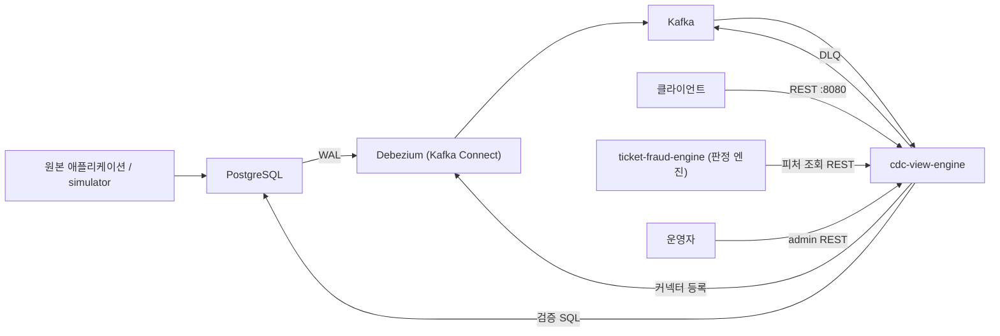

# cdc-view-engine 소프트웨어 요구사항 명세서 (SRS)

| 문서 | 버전 | 작성일 | 기준 표준 |
|---|---|---|---|
| cdc-view-engine SRS | 1.0 | 2026-11-18 | ISO/IEC/IEEE 29148:2018 |

## 1. 소개

### 1.1 목적

이 문서는 cdc-view-engine이 무엇을 해야 하는지 정의합니다. PostgreSQL 변경(CDC)을 받아 집계 뷰를 항상 최신으로 유지하고 REST로 제공하는 엔진(피처 조회 API 포함)의 기능, 성능, 신뢰성 요구사항과 그 검증 근거를 담습니다. 설계는 [SDS](SDS.md)에서 다룹니다.

### 1.2 범위

cdc-view-engine은 PostgreSQL 테이블 변경을 Debezium과 Kafka Streams로 받아, YAML로 선언한 집계 뷰(구체화 뷰)를 state store(RocksDB)에 유지하고 REST API로 제공하는 단일 인스턴스 서버입니다. 이벤트 순서 뒤집힘, 중복 전달, 비정상 종료, 스키마 변경이 있어도 뷰 값은 원본 DB와 일치해야 합니다.

범위 내:
- PostgreSQL 단일 소스 CDC (Debezium, Kafka Connect)
- YAML 뷰 정의: 소스 테이블, 조인 키, 집계 함수(count/count_distinct/sum/min/max/avg), 윈도우(tumbling/sliding), 피처 선언(`features`)
- Kafka Streams 집계 구체화 + RocksDB state store
- REST 조회 API (키 조회, 윈도우 범위 조회, ETag/freshness)
- 피처 조회 API (`POST /api/v1/features/query`, `ticket-fraud-engine` 판정 엔진용 계약)과 예시 뷰(`examples/ticket-fraud-views/`)
- 순서 뒤집힌 이벤트 처리 (LSN 기반 + grace + DLQ)
- exactly-once (EOS v2 + LSN 멱등 필터 + 재시작 안전성)
- 정합성 검증기 (소스 스냅샷 대비 뷰 비교, 온디맨드)
- 스키마 변경 중 뷰 재구축 (섀도 빌드 + 원자적 교체)
- 커머스 시뮬레이터 + docker compose 원커맨드 데모
- 벤치마크 하네스 (p50/p95/p99 지연, 처리량 리포트)

범위 외 항목은 [부록 B](#부록-b-범위-외-항목)에 있습니다.

### 1.3 제품 개요

#### 1.3.1 제품 관점

엔진은 독립 서버입니다. 원본 DB에는 읽기 전용 조회(카탈로그, 정합성 검증)와 재구축 상태 테이블 쓰기만 하고, 변경은 Kafka의 CDC 토픽으로만 받습니다.

#### 1.3.2 제품 기능

- `views/*.yaml` 뷰 정의 로딩과 부팅 시 검증
- Debezium 커넥터 자동 등록, CDC 토픽 선생성
- 소스 행 단위 LSN 가드로 역순/중복 이벤트 폐기
- count/count_distinct/sum/min/max/avg 증분 집계, tumbling/sliding 윈도우 집계
- grace 초과 지각 이벤트의 DLQ 적재와 카운터
- 뷰 키 조회, 윈도우 범위 조회, ETag/304, freshness 메타
- 뷰 YAML의 `features` 선언을 `subject.name.window` 참조 키로 노출하는 피처 조회
- 원본 스냅샷 대비 정합성 검증
- 섀도 재구축과 원자적 교체, 재구축 상태 영속화
- Prometheus 지표 노출, 벤치마크 리포트 생성

#### 1.3.3 사용자 특성

| 사용자 | 특성과 사용 상황 |
|---|---|
| 서비스 개발자 | REST와 JSON에 익숙. 무거운 집계 쿼리 대신 미리 계산된 집계(예: 판매자별 대시보드)를 조회 |
| 판정 엔진 (`ticket-fraud-engine`) | 주체(ACCOUNT/IP/CARD)와 피처 목록으로 피처 값을 조회. 제공할 수 없는 피처는 `missing`으로 받아 해당 룰만 건너뜀 |
| 운영자 | Kafka/PostgreSQL 기본 운영 지식 보유. 정합성 검증, 뷰 정의 변경 후 재구축 수행 |
| 데모 사용자 | Docker와 `curl`만 사용. `docker compose up` 한 번으로 전체 스택 실행 |

#### 1.3.4 제한 사항

| 항목 | 내용 |
|---|---|
| 언어 / 런타임 | Java 21 (Gradle toolchain) |
| 프레임워크 | Spring Boot 3.5.4 (web, actuator, jdbc), Kafka Streams, Jackson YAML, Micrometer Prometheus |
| 빌드 | Gradle 멀티 모듈 (`engine`, `simulator`) |
| 소스 DB | PostgreSQL 단일 소스. `wal_level=logical`, 대상 테이블 `REPLICA IDENTITY FULL` 필수 |
| CDC | Debezium PostgreSQL 커넥터 (`pgoutput`, JSON converter, `schemas.enable=false`, `decimal.handling.mode=double`) |
| 상태 저장 | Kafka Streams state store (RocksDB). 같은 프로세스에서 REST 서빙 |
| 배포 형태 | 단일 인스턴스. docker compose (postgres, kafka, connect, engine, simulator) |

### 1.4 용어 정의

| 용어 | 뜻 |
|---|---|
| CDC | Change Data Capture. DB 변경 로그(PostgreSQL WAL)를 읽어 변경 이벤트로 흘려보내는 방식 |
| 구체화 뷰 | 집계 결과를 미리 계산해 저장해 둔 것. 이 엔진에서는 Kafka Streams state store(RocksDB)에 저장 |
| LSN | Log Sequence Number. PostgreSQL WAL의 위치 번호. 클수록 나중 변경 |
| `ts_ms` | Debezium 이벤트의 `source.ts_ms`. 원본 커밋 시각. event time과 지연 측정의 기준 |
| before / after 이미지 | 변경 전/후 행 값. UPDATE/DELETE의 before 이미지를 얻으려면 `REPLICA IDENTITY FULL`이 필요 |
| EOS v2 | Kafka Streams `processing.guarantee=exactly_once_v2`. Kafka 내부 구간의 정확히 한 번 처리 |
| grace | 윈도우 집계에서 늦게 도착한 이벤트를 받아 주는 허용 지연 시간 |
| DLQ | Dead Letter Queue. grace를 넘긴 지각 이벤트를 보관하는 별도 Kafka 토픽 |
| 섀도 뷰 | 재구축 시 기존 뷰와 별도로 새로 만드는 다음 버전 뷰 |
| quiesce | 입력이 멈추고 consumer lag이 0인 상태 |
| freshness | 응답 값이 반영된 시점 정보(원본 커밋 시각, 뷰 반영 시각) |
| 피처 | 뷰 YAML의 `features`로 노출한 집계 필드. 주체(`subject`), 이름, 윈도우로 식별 |
| 참조 키 | 피처의 정규 이름 `subject.name.window` (예: `account.payment_attempts.10m`). 주체는 소문자 |
| `missing` | 피처 조회 응답에서 제공할 수 없는 참조 키 목록. 에러가 아님 |

## 2. 참고 문서

| 문서 | 내용 |
|---|---|
| [SDS](SDS.md) | 설계 명세 (구성, 시퀀스, 데이터, 모듈) |
| [README](../README.md) | 개요, 빠른 시작, 벤치마크 요약, 피처 조회 API |
| [SPEC](../.planning/SPEC.md) | 원본 요구사항과 수용 기준 (R1~R10) |
| [최종 완료 리포트](../.planning/v4-completion-report.md) | 수용 기준별 근거 매핑, 수동 스팟체크 |
| [데모 검증](../.planning/v1-demo-verification.md), [기동 결함 수정 검증](../.planning/v1.5-e1-fix-verification.md) | compose 기동, healthy, 5분 내 실데이터 |
| [정합성·카오스 검증](../.planning/v2-consistency-chaos-verification.md) | `kill -9` 재시작, 10만 이벤트 정합성 |
| [벤치 하네스 검증](../.planning/v3-benchmark-verification.md), [T1 지연 튜닝](../.planning/t1-latency-tuning-verification.md), [T2 처리량 스케일링](../.planning/t2-throughput-scaling-verification.md) | 지연/처리량 실측 |
| [벤치 리포트](../bench/reports/) | 실행별 리포트. 최종: `20260708-122749.md` |
| [예시 뷰](../examples/ticket-fraud-views/) | 판정 엔진용 피처 뷰 (`account-payment-attempts.yaml`, `card-daily.yaml`) |
| `ticket-fraud-engine` `docs/cdc-view-engine-contract.md` | 피처 조회 계약 (외부 저장소. `FeatureQueryApiTest`가 이 계약을 검증한다고 명시) |

## 3. 요구사항

ID 규칙: `FR-n`은 요구사항, `FR-n.m`은 그 수용 기준입니다. 출처 `Rn`은 SPEC의 요구사항 번호입니다. FR-11~FR-13은 SPEC 이후 커밋 `2d68c7f`(피처 조회 API와 count_distinct 집계)에서 추가된 기능이라 SPEC 번호가 없습니다.

### 3.1 기능 요구사항

#### FR-1 YAML 뷰 정의

| 설명 | 우선순위 | 출처 | 검증 방법 |
|---|---|---|---|
| 시스템은 서버 코드 수정 없이 YAML 파일 하나로 선언한 뷰를 부팅 시 로딩·검증해 등록해야 한다. 검증 실패 시 부팅을 중단해야 한다 | 필수 | SPEC R1 | 시험 |

수용 기준:
- FR-1.1: 소스 테이블 2개 이상 + 조인 키 + 집계 함수(count/sum/min/max/avg) + 윈도우(tumbling/sliding, 크기 + grace)를 선언하면 부팅 시 뷰가 등록된다
- FR-1.2: 필수 필드 누락 또는 알 수 없는 필드가 있으면 부팅이 실패하고, 에러 메시지에 파일명과 필드 경로가 포함된다
- FR-1.3: 데모 뷰 정의 2개(주문+재고+정산 조인 집계 뷰, 슬라이딩 윈도우 집계 뷰)가 저장소에 포함된다

#### FR-2 PostgreSQL CDC 수집

| 설명 | 우선순위 | 출처 | 검증 방법 |
|---|---|---|---|
| 시스템은 소스 테이블의 INSERT/UPDATE/DELETE 커밋을 Debezium을 거쳐 before/after, LSN, `ts_ms`가 담긴 내부 이벤트로 받아야 한다 | 필수 | SPEC R2 | 시험, 시연 |

수용 기준:
- FR-2.1: 엔진이 뷰 정의에 선언된 테이블 대상 Debezium 커넥터를 Kafka Connect REST API로 자동 등록한다
- FR-2.2: INSERT/UPDATE/DELETE 각각에 대해 before/after, LSN, `ts_ms`를 파싱한 내부 이벤트 수신을 로그 또는 메트릭으로 확인할 수 있다
- FR-2.3: `REPLICA IDENTITY FULL`이 아닌 대상 테이블이 있으면 커넥터 등록 단계에서 테이블명을 포함한 명시적 에러를 낸다

#### FR-3 집계 뷰 구체화

| 설명 | 우선순위 | 출처 | 검증 방법 |
|---|---|---|---|
| 시스템은 뷰 정의의 집계 결과를 state store에 구체화하고 소스 커밋마다 자동 갱신해야 한다 | 필수 | SPEC R3 | 시험 |

수용 기준:
- FR-3.1: 주문 INSERT 후 조인 뷰의 해당 키 집계값이 갱신된다
- FR-3.2: UPDATE 시 sum 집계에서 이전 값이 차감되고 새 값이 가산된다
- FR-3.3: DELETE 시 해당 행의 기여분이 집계에서 제거된다
- FR-3.4: 윈도우 집계는 [start, end) 반개구간을 따른다. 윈도우 종료 시각과 같은 event time의 이벤트는 다음 윈도우에 속한다

#### FR-4 REST 조회 API

| 설명 | 우선순위 | 출처 | 검증 방법 |
|---|---|---|---|
| 시스템은 REST로 뷰의 최신 값과 freshness 메타데이터를 제공해야 한다 | 필수 | SPEC R4 | 시험 |

수용 기준:
- FR-4.1: `GET /views/{view}/{key}`가 최신 집계값과 freshness(마지막 반영 이벤트의 커밋 `ts_ms`, 뷰 반영 시각)를 JSON으로 반환한다
- FR-4.2: 윈도우 뷰는 `GET /views/{view}/{key}?from={ts}&to={ts}`로 시간 범위 내 윈도우 결과 목록을 반환한다
- FR-4.3: 없는 키 또는 뷰는 404와 에러 바디(뷰명/키 명시)를 반환한다
- FR-4.4: 응답에 ETag가 포함되고, `If-None-Match`가 일치하면 304를 반환한다

#### FR-5 순서 뒤집힌 이벤트 처리

| 설명 | 우선순위 | 출처 | 검증 방법 |
|---|---|---|---|
| 시스템은 같은 키의 이벤트가 커밋 순서와 다르게 도착해도 LSN 순서대로 처리한 것과 같은 최종 뷰 값을 만들어야 한다 | 필수 | SPEC R5 | 시험 |

수용 기준:
- FR-5.1: 같은 키의 UPDATE 2건을 역순 주입하면 뷰 값은 LSN이 큰 이벤트 기준이다
- FR-5.2: DELETE가 UPDATE보다 먼저 도착해도 최종 뷰에 해당 행이 되살아나지 않는다
- FR-5.3: 윈도우 집계에서 grace(기본 30초, 뷰 정의로 설정 가능) 이내 지각 이벤트는 해당 윈도우에 반영된다
- FR-5.4: grace를 넘긴 지각 이벤트는 뷰에 반영하지 않고, DLQ 토픽에 적재하며 late-event 카운터 메트릭을 올린다

#### FR-6 exactly-once

| 설명 | 우선순위 | 출처 | 검증 방법 |
|---|---|---|---|
| 시스템은 중복 전달과 비정상 종료/재시작이 있어도 각 커밋을 정확히 한 번 반영한 집계값을 유지해야 한다 | 필수 | SPEC R6 | 시험, 시연 |

수용 기준:
- FR-6.1: Kafka Streams `processing.guarantee=exactly_once_v2`가 활성화되어 있다
- FR-6.2: 같은 LSN 이벤트를 CDC 토픽에 2회 주입해도 sum/count 값이 변하지 않는다
- FR-6.3: 처리 도중 엔진을 `kill -9` 후 재시작해도 최종 뷰 값이 무중단 실행 기대값과 같다
- FR-6.4: 위 재시작 시나리오가 자동화 스크립트로 저장소에 포함되어 반복 실행할 수 있다

#### FR-7 정합성 검증기

| 설명 | 우선순위 | 출처 | 검증 방법 |
|---|---|---|---|
| 시스템은 원본 PG 스냅샷으로 계산한 기대 뷰와 서빙 중인 뷰를 비교해 불일치 수를 리포트해야 한다 | 필수 | SPEC R7 | 시험, 시연 |

수용 기준:
- FR-7.1: `POST /admin/verify/{view}`가 소스 스냅샷 기대값과 뷰를 비교해 불일치 키 수와 불일치 샘플(최대 10건)을 반환한다
- FR-7.2: quiesce 조건에서 10만 이벤트 처리 후 불일치 0건이다
- FR-7.3: 스트림이 흐르는 중 실행하면 non-quiesced로 표시하고 pass/fail 판정을 하지 않는다
- FR-7.4: 검증 실행 중에도 뷰 조회가 계속 200으로 응답한다

#### FR-8 스키마 변경 중 뷰 재구축

| 설명 | 우선순위 | 출처 | 검증 방법 |
|---|---|---|---|
| 시스템은 소스 컬럼 추가와 뷰 정의 변경 시 기존 뷰 서빙을 멈추지 않고 뷰를 재구축해 원자적으로 교체해야 한다 | 필수 | SPEC R8 | 시험, 시연 |

수용 기준:
- FR-8.1: 뷰가 참조하지 않는 컬럼을 `ALTER TABLE ADD COLUMN` 한 뒤에도 CDC 처리와 뷰 갱신이 에러 없이 계속된다
- FR-8.2: 뷰 정의 변경 후 `POST /admin/views/{view}/rebuild`를 호출하면 섀도 뷰를 재구축하고 완료 시 원자적으로 교체한다
- FR-8.3: 재구축 시작부터 교체 완료까지 조회 결과에 5xx, 빈 응답, 신/구 혼합 응답이 없다
- FR-8.4: 재구축 중 발생한 신규 CDC 이벤트가 교체 후 뷰에 반영되어 있다(교체 후 정합성 검증 불일치 0건)
- FR-8.5: 뷰가 참조하는 컬럼이 소스에서 삭제된 상태로 재구축을 요청하면 컬럼명을 포함한 명시적 에러로 거부한다
- FR-8.6: 재구축 도중 엔진이 재시작해도 기존 뷰 서빙이 유지되고, 재구축을 다시 요청하면 정상 완료된다

#### FR-9 벤치마크 하네스

| 설명 | 우선순위 | 출처 | 검증 방법 |
|---|---|---|---|
| 시스템은 커밋 `ts_ms` 대비 뷰 반영 시각으로 지연 분포를 산출하는 하네스와 리포트를 제공해야 한다 | 필수 | SPEC R9 | 시연, 분석 |

수용 기준:
- FR-9.1: 하네스가 지연 분포(p50/p95/p99)를 산출해 리포트 파일을 생성한다
- FR-9.2: 10,000 events/sec, 10분 지속, 워밍업 60초 제외 조건에서 p95 ≤ 1,000ms 다 (NFR-1)
- FR-9.3: 리포트에 실행 하드웨어 사양(CPU, 메모리, docker 리소스 한도)이 기록된다
- FR-9.4: 부하 중 처리 실패와 DLQ 오적재가 0건이다

#### FR-10 docker compose 원커맨드 데모

| 설명 | 우선순위 | 출처 | 검증 방법 |
|---|---|---|---|
| 시스템은 `docker compose up` 한 번으로 PG, Kafka, Debezium, 엔진, 시뮬레이터를 띄우고 커머스 뷰를 REST로 조회할 수 있어야 한다 | 필수 | SPEC R10 | 시연 |

수용 기준:
- FR-10.1: PG, Kafka, Kafka Connect(Debezium), 엔진 컨테이너가 모두 healthy 상태가 된다
- FR-10.2: 엔진 `/actuator/health`가 200을 반환한다
- FR-10.3: 시뮬레이터가 함께 떠서 주문/재고/정산 데이터를 설정 가능한 속도(events/sec)로 만든다
- FR-10.4: compose up 후 5분 안에 수동 개입 없이 판매자 대시보드 뷰 조회가 실데이터를 반환한다
- FR-10.5: README의 데모 절차(명령어 3개 이하)로 재현된다

#### FR-11 피처 조회 API

| 설명 | 우선순위 | 출처 | 검증 방법 |
|---|---|---|---|
| 시스템은 `POST /api/v1/features/query`로 주체 유형, 주체 키, 피처 목록을 받아 뷰 YAML에 선언된 피처 값을 참조 키(`subject.name.window`)별로 반환하고, 제공할 수 없는 피처는 `missing`으로 응답해야 한다 | 필수 | 커밋 2d68c7f, README 피처 조회 API | 시험 |

수용 기준:
- FR-11.1: 선언된 피처를 조회하면 200과 함께 `values`에 정규 참조 키(예: `account.payment_attempts.10m`)로 값이 들어가고 `missing`은 비어 있다
- FR-11.2: 값은 지금을 포함하는 윈도우 중 가장 오래된 것에서 읽는다. sliding 뷰의 정밀도는 advance 단위이고 tumbling 뷰는 현재 고정 구간이다
- FR-11.3: 구간에 행이 없는 count 피처는 `missing`이 아니라 0이다
- FR-11.4: 구간에 행이 없으면 count_distinct, sum 피처도 0이고, min/max/avg 피처는 값이 없어 `missing`이다
- FR-11.5: 한 뷰에 선언된 여러 피처를 한 요청으로 조회할 수 있다
- FR-11.6: 선언되지 않은 피처는 에러가 아니라 200 응답의 `missing`에 참조 키로 들어간다
- FR-11.7: `subjectType`이 ACCOUNT, IP, CARD가 아니거나 `subjectKey`가 비어 있으면 400이다
- FR-11.8: Streams가 RUNNING 상태가 아니면 503이다
- FR-11.9: `ticket-fraud-engine`과 두 서비스를 실제로 띄운 연동에서 계약대로 동작한다

#### FR-12 count_distinct 집계

| 설명 | 우선순위 | 출처 | 검증 방법 |
|---|---|---|---|
| 시스템은 `count_distinct` 집계로 그룹별 고유 값 수를 유지하고, UPDATE와 DELETE를 정확히 되돌려야 한다 | 필수 | 커밋 2d68c7f, README 피처 조회 API | 시험 |

수용 기준:
- FR-12.1: 같은 값의 행이 여러 개여도 그 값은 한 번만 센다
- FR-12.2: DELETE는 그 값의 마지막 행이 지워질 때만 고유 값 수를 줄인다
- FR-12.3: UPDATE로 값이 바뀌면 행이 이전 값에서 새 값으로 옮겨진다
- FR-12.4: NULL은 세지 않는다 (SQL `COUNT(DISTINCT)`와 같음)
- FR-12.5: state store 직렬화(JSON)를 거쳐도 값이 유지된다
- FR-12.6: 정합성 검증기의 기대값 SQL은 `COUNT(DISTINCT column)`이다

#### FR-13 피처 선언과 부팅 시 검증

| 설명 | 우선순위 | 출처 | 검증 방법 |
|---|---|---|---|
| 시스템은 뷰 YAML의 `features` 선언(주체, 이름, 윈도우, 집계 필드)을 부팅 시 로딩·검증하고, 잘못된 선언이면 파일명과 필드 경로를 담아 부팅을 중단해야 한다 | 필수 | 커밋 2d68c7f, README 피처 조회 API | 시험 |

수용 기준:
- FR-13.1: `features[]`(`subject`, `name`, `window`, `field`)를 선언한 윈도우 뷰가 부팅 시 등록되고 피처 조회 API로 노출된다
- FR-13.2: `field`가 집계 결과 필드(`as`)에 없으면 `features[i].field` 경로로 부팅이 실패한다
- FR-13.3: 피처 `window`가 뷰의 `window.size`와 다르면 `features[i].window` 경로로 부팅이 실패한다
- FR-13.4: 비윈도우 뷰에 피처를 선언하거나 `subject`, `name`, `window`, `field` 중 하나가 없으면 부팅이 실패한다
- FR-13.5: 기간 표기에 일 단위 `1d`를 쓸 수 있다
- FR-13.6: 판정 엔진용 예시 뷰 2개(`account-payment-attempts.yaml`, `card-daily.yaml`)가 `examples/ticket-fraud-views/`에 포함되고 `views.directory`로 지정해 쓸 수 있다

### 3.2 성능 요구사항

| ID | 요구사항 | 목표치 | 검증 방법 |
|---|---|---|---|
| NFR-1 | DB 커밋 → 뷰 반영 지연 (`ts_ms` 기준, 워밍업 60초 제외) | 10,000 events/sec, 10분 지속에서 p95 ≤ 1,000ms | 시연 (`bench/run-bench.sh`) |
| NFR-2 | 지속 부하에서 처리가 밀리지 않음 | 측정 종료 시 consumer lag 0 | 시연 (`bench/run-bench.sh`) |

### 3.3 사용성 요구사항

| ID | 요구사항 | 목표치 | 검증 방법 |
|---|---|---|---|
| NFR-3 | 원커맨드 데모 | 명령어 3개 이하, compose up 후 5분 안에 실데이터 조회 | 시연 (`scripts/demo-check.sh`) |
| NFR-4 | 뷰 정의 오류 메시지 | 파일명 + 필드 경로 포함 | 시험 |

### 3.4 인터페이스 요구사항

| 구분 | 인터페이스 | 내용 |
|---|---|---|
| 사용자 | REST API (HTTP, JSON) | `GET /views/{view}/{key}`, `POST /api/v1/features/query`, `POST /admin/verify/{view}`, `POST /admin/views/{view}/rebuild`, `GET /admin/views/{view}/rebuild/status`. 상세는 [SDS 3.5](SDS.md#35-인터페이스-뷰) |
| 사용자 | 뷰 정의 파일 | `views/*.yaml` (`name`, `sources`, `group_by`, `aggregations`, `window`, `features`). 디렉터리는 `views.directory`(`CDCVIEW_VIEWS_DIR`, 기본 `views`) |
| 소프트웨어 | `ticket-fraud-engine` | 판정 엔진이 피처 조회 API의 소비자. 계약은 그쪽 저장소의 `docs/cdc-view-engine-contract.md` |
| 소프트웨어 | PostgreSQL | JDBC. `pg_class`(REPLICA IDENTITY 확인), `information_schema.columns`(참조 컬럼 확인), 소스 테이블 집계 SQL(검증), `cdcview_rebuild_state` 읽기/쓰기 |
| 소프트웨어 | Kafka Connect REST | `PUT /connectors/{name}/config` (Debezium 커넥터 등록) |
| 소프트웨어 | Kafka | CDC 토픽 `cdcview.public.{table}` 소비, DLQ 토픽 `cdcview.dlq.late-events` 생산, AdminClient(토픽 생성, consumer lag 조회) |
| 통신 | 포트 | 엔진 8080, PostgreSQL 5432, Kafka 9092, Kafka Connect 8083 |
| 통신 | 관측 | `/actuator/health`, `/actuator/metrics`, `/actuator/prometheus` |

### 3.5 논리 데이터 요구사항

| 데이터 | 저장 위치 | 보존 요구 |
|---|---|---|
| 소스 테이블 (`orders`, `inventory`, `settlements`) | PostgreSQL | 원본. 엔진은 쓰지 않음 |
| CDC 변경 이벤트 | Kafka CDC 토픽 | 섀도 재구축이 처음부터 다시 읽을 수 있도록 전체 이력이 남아 있어야 함 |
| 뷰 집계 상태 (그룹 키 → 누산 값 + freshness) | RocksDB state store + changelog 토픽 | 재시작 후 복원. count_distinct는 값별 행 수를 보관하므로 저장 공간이 고유 값 수에 비례 |
| 소스 행별 최고 LSN | RocksDB state store (`lsn-guard-*`) | 재시작 후 복원 (중복 방지의 근거) |
| 지각 이벤트 | DLQ 토픽 | 버리지 않고 보관 |
| 재구축 상태 (뷰당 최신 1건) | PostgreSQL `cdcview_rebuild_state` | 엔진 재시작 후에도 조회 가능 |

### 3.6 설계 제약

- 뷰 상태는 Kafka Streams state store(RocksDB)에 두고 같은 프로세스에서 서빙한다
- 이벤트 순서 기준은 PostgreSQL LSN이다 (같은 행에서 last-write-wins)
- event time은 처리 시각이 아니라 커밋 시각(`ts_ms`)이다
- 윈도우는 tumbling, sliding(hopping) 2종이며 [start, end) 반개구간이다. grace 기본값은 30초다
- 기간 표기는 `ms`, `s`, `m`, `h`, `d` 단위다
- 피처는 윈도우 뷰에만 선언할 수 있고, 피처 윈도우는 뷰의 `window.size`와 같아야 한다. 피처의 주체 키는 뷰의 `group_by` 값이다
- 피처 주체 유형은 ACCOUNT, IP, CARD 3종이다
- 재구축은 수동 REST 트리거로만 시작한다
- 대상 테이블은 `REPLICA IDENTITY FULL`이어야 한다
- 단일 인스턴스를 전제한다

### 3.7 소프트웨어 시스템 속성

| ID | 속성 | 요구사항 | 목표치 | 검증 방법 |
|---|---|---|---|---|
| NFR-5 | 신뢰성 | 같은 커밋(LSN)은 어떤 경로로도 집계에 2회 반영되지 않음 | 중복 반영 0 | 시험 |
| NFR-6 | 신뢰성 | 비정상 종료(`kill -9`) 후 재시작해도 유실/중복 없음 | 기대값과 정확히 일치 | 시연 |
| NFR-7 | 신뢰성 | quiesce 상태에서 원본 대비 뷰 정합성 | 불일치 0 그룹 | 시연 |
| NFR-8 | 신뢰성 | 지각 이벤트를 흔적 없이 버리지 않음 | grace 초과분 전부 DLQ 적재 + 카운터 | 시험 |
| NFR-9 | 가용성 | 재구축 중과 교체 시점에 조회가 끊기거나 섞이지 않음 | 5xx/빈/혼합 응답 0건 | 시연 |
| NFR-10 | 가용성 | 정합성 검증이 조회를 막지 않음 | 검증 중 조회 200 | 시연 |
| NFR-11 | 유지보수성 | 관측 지표 노출 (`/actuator/prometheus`) | `cdc.events.received`, `view.apply.latency`, `view.stale.dropped`, `view.late.events` | 검사 |
| NFR-12 | 이식성 | 외부 접속 정보는 환경변수로 주입 | `application.yml`의 접속 값 전부 env 오버라이드 가능 | 검사 |
| NFR-13 | 이식성 | 데모 스택 버전 | PostgreSQL 16, Kafka 3.9.0 (KRaft 단일 노드), Debezium Connect 3.0.0.Final | 시연 |

보안 속성은 요구사항이 없습니다. 인증은 범위 외입니다 (부록 B).

### 3.8 금지 조건 (must-NOT)

- 같은 커밋(LSN)이 어떤 경로로도 집계에 2회 반영되면 안 된다 (FR-6.2)
- 재구축 교체 시점에 API가 빈 결과나 신/구 뷰가 섞인 결과를 반환하면 안 된다 (FR-8.3)
- grace를 넘긴 지각 이벤트를 흔적 없이 버리면 안 된다. DLQ 적재와 메트릭이 필수다 (FR-5.4)
- 정합성 검증이 뷰 서빙을 막으면 안 된다 (FR-7.4)
- 선언되지 않은 피처 조회를 에러로 응답하면 안 된다. `missing`으로 응답한다 (FR-11.6)

## 4. 검증

### 4.1 검증 방법

| 방법 | 수단 | 실행 |
|---|---|---|
| 시험 (단위) | JUnit 5. 토폴로지는 `TopologyTestDriver`, REST와 피처 조회는 `MockMvc` + 페이크 `StoreAccess`(피처 조회는 고정 `Clock`), 재구축은 페이크 `ShadowBuilder` | `./gradlew :engine:test` |
| 시험 (통합) | Testcontainers PostgreSQL (`*IT`). Docker가 없으면 skip. 로컬은 `DOCKER_API_VERSION=1.44`가 필요할 수 있음 | `./gradlew :engine:test` |
| 시연 (카오스) | 결정적 시드 200건 커밋 후 엔진 `kill -9`, 재기동 후 count/sum 확인 | `bash scripts/chaos-restart-test.sh` |
| 시연 (데모) | compose 기동부터 실데이터 조회까지 5분 타임아웃 | `bash scripts/demo-check.sh` |
| 시연 (정합성) | quiesce 후 검증 호출 | `curl -X POST http://localhost:8080/admin/verify/seller-dashboard` |
| 시연 (성능) | 10,000 events/sec, 10분, 워밍업 60초 제외. 리포트는 `bench/reports/` | `bash bench/run-bench.sh` |
| 검사 | 설정 파일, 코드 확인 | - |

마지막 로컬 테스트 결과(`engine/build/test-results/test`): 18개 클래스, 64개 테스트, 59 통과, 5 skip(`ReplicaIdentityCheckerIT` 2, `JdbcRebuildStateStoreIT` 3), 0 실패. 이 결과는 커밋 `2d68c7f` 이전 실행이라 그 커밋에서 추가된 `api/FeatureQueryApiTest`(7개)와 `topology/CountDistinctTest`(7개)는 포함되어 있지 않습니다. CI(`.github/workflows/ci.yml`)는 push(master)와 pull request마다 `./gradlew test`를 실행합니다.

### 4.2 요구사항 추적표

구현 경로는 `engine/src/main/java/io/github/nini4746/cdcview/`, 테스트 경로는 `engine/src/test/java/io/github/nini4746/cdcview/` 기준입니다. 리포트 파일은 `.planning/` 아래에 있습니다.

| ID | 요구사항 | 구현 위치 | 검증 근거 | 상태 |
|---|---|---|---|---|
| FR-1.1 | 다중 소스 + 집계 + 윈도우 선언 등록 | `config/ViewDefinitionLoader.java`, `config/ViewRegistry.java` | `config/ViewDefinitionTest.loadsJoinedWindowedView` | 충족 |
| FR-1.2 | 잘못된 YAML이면 파일명 + 필드 경로로 부팅 실패 | `config/ViewDefinitionLoader.java`, `config/ViewDefinitionFailureAnalyzer.java` | `ViewDefinitionTest.missingRequiredFieldFails`, `unknownFieldFails`, `slidingWithoutAdvanceFails`, `duplicateNameFails` | 충족 |
| FR-1.3 | 데모 뷰 2개 포함 | `views/seller-dashboard.yaml`, `views/seller-sales-window.yaml` | `ViewDefinitionTest.loadsBothDemoViews` | 충족 |
| FR-2.1 | 커넥터 자동 등록 | `cdc/ConnectorRegistrar.java`, `cdc/ConnectorConfigFactory.java` | `cdc/ConnectorConfigFactoryTest`, `v1-demo-verification.md` | 충족 |
| FR-2.2 | before/after, LSN, `ts_ms` 파싱 | `cdc/ChangeEventParser.java`, `cdc/CdcMetrics.java` | `cdc/ChangeEventParserTest` (7개), 벤치 리포트의 `cdc.events.received` 누적 수신 | 충족 |
| FR-2.3 | `REPLICA IDENTITY FULL` 아니면 명시적 에러 | `cdc/ReplicaIdentityChecker.java` | `cdc/ReplicaIdentityCheckerIT` (로컬 skip), `v1.5-e1-fix-verification.md`에 `DOCKER_API_VERSION=1.44`로 통과 기록 | 충족 |
| FR-3.1 | INSERT 후 집계 갱신 | `topology/TopologyBuilder.java`, `topology/AggregateState.java` | `topology/TopologyMaterializeTest.insertUpdatesAggregate` | 충족 |
| FR-3.2 | UPDATE 시 이전 값 차감 + 새 값 가산 | `topology/AggregateState.java` | `TopologyMaterializeTest.updateSubtractsOldAddsNew` | 충족 |
| FR-3.3 | DELETE 시 기여분 제거 | `topology/AggregateState.java` | `TopologyMaterializeTest.deleteRemovesContribution`, `minRecomputesOnDelete` | 충족 |
| FR-3.4 | 윈도우 [start, end) 반개구간 | `topology/TopologyBuilder.java`, `topology/EventTimeExtractor.java` | `TopologyMaterializeTest.windowBoundaryIsHalfOpen` | 충족 |
| FR-4.1 | 최신 값 + freshness | `api/ViewQueryController.java`, `api/ViewQueryService.java` | `api/ViewQueryApiTest.latestReturnsValuesAndFreshness` | 충족 |
| FR-4.2 | 윈도우 범위 조회 | `api/ViewQueryService.java`, `api/KafkaStreamsStoreAccess.java` | `ViewQueryApiTest.windowRangeReturnsWindows` | 충족 |
| FR-4.3 | 없는 뷰/키 404 | `api/ApiExceptionHandler.java`, `api/exceptions.java` | `ViewQueryApiTest.unknownViewReturns404`, `unknownKeyReturns404` | 충족 |
| FR-4.4 | ETag + `If-None-Match` 304 | `api/ViewQueryController.java`, `api/ViewQueryService.java` | `ViewQueryApiTest.etagMatchReturns304` | 충족 |
| FR-5.1 | 역순 UPDATE는 LSN 큰 값 기준 | `ordering/LsnGuard.java` | `ordering/OrderingTest.reversedUpdatesKeepHighestLsn` | 충족 |
| FR-5.2 | DELETE 먼저 도착해도 행 부활 없음 | `ordering/LsnGuard.java` | `OrderingTest.deleteBeforeLowerLsnUpdateDoesNotRevive` | 충족 |
| FR-5.3 | grace 이내 지각 반영 | `ordering/LateEventHandler.java` | `ordering/LateEventTest.withinGraceIsApplied` | 충족 |
| FR-5.4 | grace 초과 → DLQ + 카운터 | `ordering/LateEventHandler.java`, `ordering/OrderingMetrics.java` | `LateEventTest.beyondGraceGoesToDlqAndCounter` | 충족 |
| FR-6.1 | `exactly_once_v2` 활성화 | `topology/StreamsConfigFactory.java` | `topology/ExactlyOnceConfigTest.defaultsToExactlyOnceV2` | 충족 |
| FR-6.2 | 같은 LSN 2회 주입에도 값 불변 | `ordering/LsnGuard.java` | `topology/ExactlyOnceDedupTest` (2개), `OrderingTest.sameLsnDuplicateIsDropped` | 충족 |
| FR-6.3 | `kill -9` 후 재시작해도 값 정확 | `topology/StreamsConfigFactory.java`, `ordering/LsnGuard.java` | `v2-consistency-chaos-verification.md` (count=200, sum=20100), `t2-throughput-scaling-verification.md` | 충족 |
| FR-6.4 | 재시작 시나리오 자동화 스크립트 | `scripts/chaos-restart-test.sh` | `v2-consistency-chaos-verification.md` (2회 연속 exit 0) | 충족 |
| FR-7.1 | 스냅샷 비교 + 샘플 리포트 | `verify/VerificationService.java`, `verify/SqlExpectedViewProvider.java`, `verify/ExpectedViewSqlGenerator.java` | `verify/VerificationServiceTest`, `verify/ExpectedViewSqlGeneratorTest` | 충족 |
| FR-7.2 | 10만 이벤트 후 불일치 0 | 위와 같음 | `v2-consistency-chaos-verification.md` (102,655 이벤트, mismatch 0/100) | 충족 |
| FR-7.3 | non-quiesced면 판정 없음 | `verify/VerificationService.java`, `verify/KafkaQuiesceChecker.java` | `VerificationServiceTest.nonQuiescedHasNoVerdict` | 충족 |
| FR-7.4 | 검증 중 조회 200 유지 | `verify/VerificationService.java` (read-only 스캔) | `v4-completion-report.md` 수동 스팟체크 (verify 20회 중 GET 50건 전부 200). 회귀 테스트 없음 | 충족 |
| FR-8.1 | 미참조 컬럼 추가 시 무중단 | `cdc/ChangeEventParser.java` (행을 컬럼명 맵으로 파싱) | `v4-completion-report.md` 수동 스팟체크 (ADD COLUMN 후 order_count 90→99). 회귀 테스트 없음 | 충족 |
| FR-8.2 | 섀도 재구축 후 원자적 교체 | `rebuild/RebuildService.java`, `rebuild/KafkaShadowBuilder.java`, `config/ViewRegistry.java` | `rebuild/RebuildServiceTest.rebuildSwapsToNewVersion` (섀도 빌더는 페이크). `KafkaShadowBuilder` 실 실행 기록 없음 | 충족 |
| FR-8.3 | 재구축~교체 구간 5xx/빈/혼합 0 | `config/ViewRegistry.java` (단일 포인터 교체), `api/InstanceDirectory.java` | `RebuildServiceTest.versionStaysUntilCaughtUp`은 교체 전 버전 유지만 확인. REST 조회 루프 실측 없음 | 미검증 |
| FR-8.4 | 재구축 중 신규 이벤트가 교체 후 반영 | `rebuild/KafkaShadowBuilder.java` (lag 0 판정) | 실 Kafka 섀도로 재구축 후 정합성 검증한 기록 없음 | 미검증 |
| FR-8.5 | 참조 컬럼 삭제 시 명시적 거부 | `rebuild/ColumnChecker.java` | `RebuildServiceTest.missingColumnRejectsRebuild`, `rebuild/ColumnCheckerTest.detectsMissingReferencedColumn` | 충족 |
| FR-8.6 | 재구축 중 재시작 후 재요청 정상 | `rebuild/RebuildService.java`, `rebuild/JdbcRebuildStateStore.java` | `RebuildServiceTest.crashMidRebuildIsDetectedAsAbortedOnRestart`, `rebuild/JdbcRebuildStateStoreIT` (로컬 skip) | 충족 |
| FR-9.1 | 지연 분포 리포트 생성 | `bench/run-bench.sh`, `cdc/CdcMetrics.java` | `bench/reports/*.md` (12개), `v3-benchmark-verification.md` | 충족 |
| FR-9.2 | 10,000/s, 10분, p95 ≤ 1s | 위와 같음 | `bench/reports/20260708-122749.md` (p95 537ms, PASS) | 충족 |
| FR-9.3 | 하드웨어 사양 기록 | `bench/run-bench.sh` | `bench/reports/20260708-122749.md` 하드웨어 / 리소스 절 | 충족 |
| FR-9.4 | 처리 실패와 DLQ 오적재 0 | `ordering/LateEventHandler.java` | `bench/reports/20260708-122749.md` (DLQ 0) | 충족 |
| FR-10.1 | 4개 서비스 healthy | `docker-compose.yml` | `v1-demo-verification.md` (+34초) | 충족 |
| FR-10.2 | actuator health 200 | `engine/src/main/resources/application.yml` | `v1-demo-verification.md`, `ContextLoadTest.contextLoadsAndHealthIsUp` | 충족 |
| FR-10.3 | 시뮬레이터 동반 구동 + 속도 조절 | `simulator/src/main/java/io/github/nini4746/cdcview/simulator/Simulator.java`, `docker-compose.yml` | `v1-demo-verification.md`, `v2-consistency-chaos-verification.md` (target 300 = achieved 300) | 충족 |
| FR-10.4 | 5분 안에 실데이터 | `cdc/CdcTopicProvisioner.java`, `scripts/demo-check.sh` | `v1.5-e1-fix-verification.md` (52초) | 충족 |
| FR-10.5 | README 절차 재현 | `README.md` | `v1.5-e1-fix-verification.md` | 충족 |
| FR-11.1 | 정규 참조 키로 값 반환 | `api/FeatureQueryController.java`, `api/FeatureQueryService.java`, `api/dto.java` | `api/FeatureQueryApiTest.returnsValueUnderCanonicalKey` | 충족 |
| FR-11.2 | 지금을 포함한 가장 오래된 윈도우에서 읽기 | `api/FeatureQueryService.java` (`readFeature`) | `FeatureQueryApiTest.readsOldestWindowContainingNow` | 충족 |
| FR-11.3 | 행 없는 count 피처는 0 | `api/FeatureQueryService.java` (`emptyWindowValue`) | `FeatureQueryApiTest.noRowsInWindowIsZeroNotMissing` | 충족 |
| FR-11.4 | 행 없는 count_distinct/sum은 0, min/max/avg는 `missing` | `api/FeatureQueryService.java` (`emptyWindowValue`) | 코드만 있음. 이 경우를 다루는 테스트 없음 | 미검증 |
| FR-11.5 | 한 뷰의 여러 피처 조회 | `api/FeatureQueryService.java` | `FeatureQueryApiTest.servesSeveralFeaturesFromOneView` | 충족 |
| FR-11.6 | 미선언 피처는 `missing` | `api/FeatureQueryService.java` (`read`) | `FeatureQueryApiTest.undeclaredFeatureIsMissing` | 충족 |
| FR-11.7 | 잘못된 주체 유형/빈 주체 키 400 | `api/FeatureQueryService.java`, `api/ApiExceptionHandler.java` | `FeatureQueryApiTest.unknownSubjectTypeIs400`, `blankSubjectKeyIs400` | 충족 |
| FR-11.8 | Streams 미준비 503 | `api/FeatureQueryService.java`, `api/ApiExceptionHandler.java` | 피처 조회 경로의 503 테스트 없음 | 미검증 |
| FR-11.9 | `ticket-fraud-engine` 실제 연동 | - | README: 두 서비스를 실제로 띄운 연동과 지연 측정은 아직 하지 않음 | 미검증 |
| FR-12.1 | 같은 값은 한 번만 셈 | `topology/AggregateState.java` (`distincts`) | `topology/CountDistinctTest.countsEachValueOnce` | 충족 |
| FR-12.2 | 마지막 행 삭제 시에만 감소 | `topology/AggregateState.java` | `CountDistinctTest.deleteRemovesValueOnlyWithItsLastRow` | 충족 |
| FR-12.3 | UPDATE 시 값 이동 | `topology/AggregateState.java` | `CountDistinctTest.updateMovesRowBetweenValues` | 충족 |
| FR-12.4 | NULL 미집계 | `topology/AggregateState.java` | `CountDistinctTest.nullIsNotCounted` | 충족 |
| FR-12.5 | 직렬화 후 유지 | `topology/AggregateState.java` (`getDistincts`/`setDistincts`) | `CountDistinctTest.survivesJsonRoundTrip` | 충족 |
| FR-12.6 | 검증기 SQL `COUNT(DISTINCT)` | `verify/ExpectedViewSqlGenerator.java` | `ExpectedViewSqlGeneratorTest`에 count_distinct 사례 없음 | 미검증 |
| FR-13.1 | `features` 선언 로딩과 노출 | `config/ViewDefinition.java` (`Feature`, `SubjectType`), `config/ViewDefinitionLoader.java` | `FeatureQueryApiTest` (예시 뷰 디렉터리를 `ViewRegistry`로 로딩) | 충족 |
| FR-13.2 | 없는 집계 필드 참조 시 부팅 실패 | `config/ViewDefinitionLoader.java` (`validateFeatures`) | `CountDistinctTest.featureFieldMustExist` | 충족 |
| FR-13.3 | 피처 윈도우 불일치 시 부팅 실패 | `config/ViewDefinitionLoader.java` (`validateFeatures`) | `CountDistinctTest.featureWindowMustMatchView` | 충족 |
| FR-13.4 | 비윈도우 뷰 선언, 하위 필드 누락 시 부팅 실패 | `config/ViewDefinitionLoader.java` (`validateFeatures`) | 코드만 있음. 이 경우를 다루는 테스트 없음 | 미검증 |
| FR-13.5 | 기간 표기 `1d` | `config/Durations.java` | `card-daily.yaml`(`size: 1d`, 피처 `window: 1d`) 로딩과 `FeatureQueryApiTest.servesSeveralFeaturesFromOneView` | 충족 |
| FR-13.6 | 예시 뷰 2개 포함 | `examples/ticket-fraud-views/` | `FeatureQueryApiTest`, `CountDistinctTest`가 예시 뷰를 로딩 | 충족 |
| NFR-1 | p95 ≤ 1s @ 10,000/s | FR-9와 같음 | `bench/reports/20260708-122749.md` | 충족 |
| NFR-2 | 측정 종료 시 lag 0 | FR-9와 같음 | `bench/reports/20260708-122749.md` (lag 0) | 충족 |
| NFR-3 | 원커맨드 데모 | FR-10.4, FR-10.5와 같음 | `v1.5-e1-fix-verification.md` | 충족 |
| NFR-4 | 오류 메시지에 파일명 + 필드 경로 | FR-1.2와 같음 | FR-1.2와 같음 | 충족 |
| NFR-5 | 중복 반영 0 | `ordering/LsnGuard.java` | FR-6.2와 같음 | 충족 |
| NFR-6 | 재시작 후 유실/중복 0 | FR-6.3과 같음 | FR-6.3과 같음 | 충족 |
| NFR-7 | 정합성 불일치 0 | FR-7.2와 같음 | FR-7.2와 같음 | 충족 |
| NFR-8 | 지각 이벤트 무흔적 폐기 금지 | FR-5.4와 같음 | FR-5.4와 같음 | 충족 |
| NFR-9 | 재구축 중 조회 무중단/무혼합 | FR-8.3과 같음 | FR-8.3과 같음 | 미검증 |
| NFR-10 | 검증 중 조회 200 | FR-7.4와 같음 | FR-7.4와 같음 | 충족 |
| NFR-11 | 관측 지표 노출 | `cdc/CdcMetrics.java`, `ordering/OrderingMetrics.java`, `application.yml` | `LateEventTest.beyondGraceGoesToDlqAndCounter`(카운터), 벤치 리포트(`view.apply.latency` 스크레이프) | 충족 |
| NFR-12 | 접속 정보 env 주입 | `engine/src/main/resources/application.yml`, `docker-compose.yml` | 설정 파일 검사만. 별도 테스트 없음 | 미검증 |
| NFR-13 | 데모 스택 버전 | `docker-compose.yml` | `v1-demo-verification.md` (compose 기동) | 충족 |

## 부록 A. 가정과 의존성

- PostgreSQL이 `wal_level=logical`로 떠 있고, 접속 계정에 `REPLICATION` 권한이 있다 (`docker/postgres/init.sql`)
- 대상 테이블은 `REPLICA IDENTITY FULL`로 설정되어 있다
- Kafka Connect에 Debezium PostgreSQL 커넥터가 설치되어 있다 (`quay.io/debezium/connect:3.0.0.Final`)
- 그룹 키(`seller_id`)는 UPDATE로 바뀌지 않는다
- CDC 토픽에 전체 이력이 남아 있다 (섀도 재구축이 earliest부터 다시 읽음)
- 지연 측정은 PG와 엔진이 같은 docker 호스트 시계를 쓴다는 전제에서 clock skew를 무시한다
- 10,000 events/sec 결과는 8 CPU / 16GB 단일 호스트(Docker 8 NCPU / ~7.75GB) 기준이다
- 예시 뷰(`examples/ticket-fraud-views/`)의 소스 `payment` 테이블은 데모 스키마(`docker/postgres/init.sql`)에 없다. 예시 뷰는 그 테이블이 있는 환경에서 `views.directory`로 지정해 쓴다
- 피처 시간 기준은 UTC다 (`card-daily`의 당일은 UTC 기준)
- 피처 조회는 계약과 집계를 단위 테스트로만 검증했다. `ticket-fraud-engine`과 두 서비스를 실제로 띄운 연동과 지연 측정은 하지 않았고, 피처 조회 지연에는 목표치가 없다 (README)

## 부록 B. 범위 외 항목

| 항목 | 이유 |
|---|---|
| 관리 UI | REST + 설정 파일로 충분 |
| 멀티 인스턴스 수평 확장 | interactive query 라우팅은 별도 프로젝트 규모. 단일 인스턴스로 핵심 문제를 다룰 수 있음 |
| 인증 / 멀티테넌시 | 보안 계층은 이 엔진을 쓰는 쪽의 몫 |
| 비 PostgreSQL 소스 (MySQL, MongoDB 등) | 커넥터 추상화 비용 대비 이득이 작음 |
| 외부 캐시(Redis) 자동 무효화 | REST ETag로 캐시 검증 가능 |
| 뷰 정의 핫 리로드 | 뷰 정의 변경은 재구축 절차(FR-8)로만 반영 |
| 뷰가 참조하는 컬럼의 삭제 지원 | 컬럼 추가와 뷰 정의 변경만 지원. 참조 컬럼 삭제는 명시적 에러로 거부(FR-8.5) |
| 윈도우 뷰 정합성 검증 | 검증기는 비윈도우 뷰만 지원. 윈도우 뷰 요청은 400으로 거부 |
| 그룹 키가 바뀌는 UPDATE (예: 주문의 `seller_id` 변경) | 데모 도메인에서 그룹 키는 불변 |
| 피처 `ip.distinct_accounts.1h` | `payment` 테이블에 IP 컬럼 없음. 조회 시 `missing` |
| 피처 `account.hold_release_cycles.10m` | 선점 해제 이력 테이블 없음. 조회 시 `missing` |
| `card.cumulative_amount.1d`의 승인 건 필터 | 승인 건만 거르는 필터가 없어 모든 결제 행을 합산 |
| 재구축 재개 | 엔진 재시작 시 섀도 스트림도 사라지므로 `ABORTED`로 표시하고 처음부터 재요청 |
